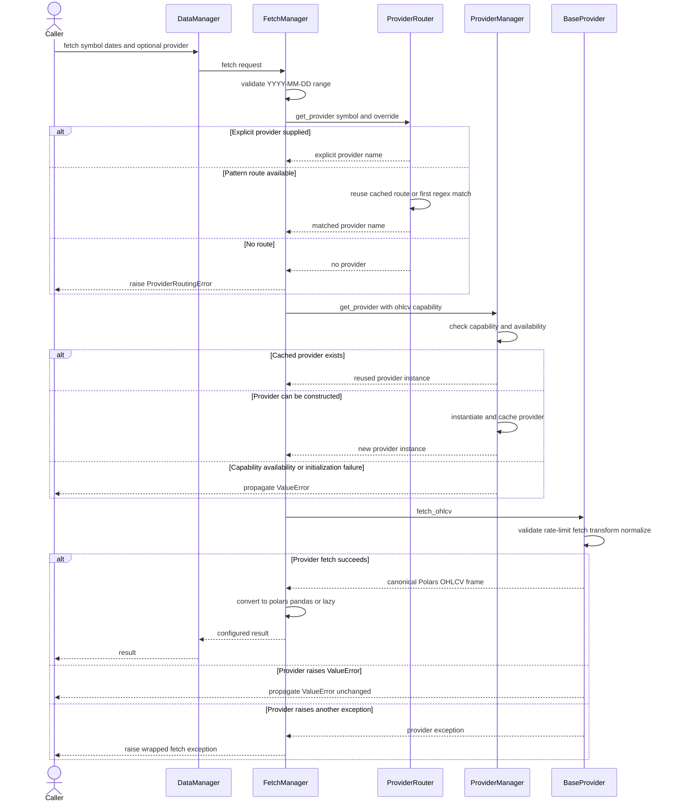

# DataManager Runtime and Delegated Managers

`DataManager` is the synchronous, user-facing facade for market-data access. It assembles configuration, routing, provider lifecycle, fetching, batching, and—when a storage backend is supplied—storage, metadata, and bulk-update services. The facade deliberately keeps most behavior in focused manager objects rather than implementing provider or persistence logic itself.

For the wider context, see [System Overview](system-overview.md), [Provider System](../integrations/provider-system.md), [Configuration and CLI](../operations/configuration-and-cli.md), and [Acquire, Validate, and Persist](../workflows/acquire-validate-and-persist.md).

## Construction and ownership

Construction is eager for the configuration and fetch path:

1. `ConfigManager` loads and merges the runtime configuration.
2. `ProviderRouter` receives configured regex routes. `setup_default_patterns()` adds its built-ins only when no configured pattern was added.
3. `ProviderManager` discovers manager-compatible, configured providers and owns their instantiated objects.
4. `FetchManager` receives the provider manager, router, and selected output format.
5. `BatchManager` receives the same fetch manager and the optional storage backend.

Storage changes the owned graph. `StorageManager` and `MetadataManager` are created only when `storage` is truthy, and `BulkManager` exists only when both are available. Storage-dependent facade methods reject calls with `ValueError` when the corresponding manager is absent. Session assignment and completion are exceptions: they can use a temporary `MetadataManager(None)` because they do not inherently require persisted metadata.

The resulting ownership boundary is important: the router caches **routing decisions**, `ProviderManager` caches **live provider instances**, and `BatchManager` only coordinates work through `FetchManager`. `DataManager.providers`, `router`, `config`, and several underscored methods remain compatibility surfaces, but new behavior belongs in the focused manager that owns it.

The constructor also rejects the removed `use_transactions` option. Supported storage writes are expected to use the storage system's atomic generation behavior rather than a facade-level transaction switch.

## Configuration and provider availability

`ConfigManager` applies sources in this effective order, from lower to higher priority:

1. built-in defaults, or a typed YAML configuration loaded by `ConfigLoader`;
2. credential environment variables derived from the provider registry;
3. constructor overrides for provider settings, output format, and recognized default keys.

Provider overrides are validated with `DataConfig` before they are deep-merged. A configured instance may be an alias such as `yahoo_main` whose `type` points to the registered provider implementation. Overrides targeted at that alias preserve its configured type. Invalid provider overrides become an actionable `ValueError`; an output format outside `polars`, `pandas`, or `lazy` is also rejected.

Availability is registry-driven rather than equivalent to “a provider class exists.” `ProviderManager` loads only `manager_compatible` implementations that can be imported, binds configured aliases, and asks each `ProviderSpec` whether its credential and required-configuration conditions are met. Missing optional provider packages leave aliases unavailable rather than aborting manager startup. `list_providers()` returns this detected set. `get_provider_info()` can describe a registered provider even when unavailable and strips known secret fields from both top-level and nested `extra` configuration.

See [`config_manager.py`](../../src/ml4t/data/managers/config_manager.py) and [`provider_manager.py`](../../src/ml4t/data/managers/provider_manager.py) for the configuration and availability rules.

## Routing, provider reuse, and a managed fetch

The provider can be selected in two ways:

- an explicit `provider=` argument, which takes precedence;
- the first configured regex whose `match()` accepts the symbol.

Pattern results are cached by symbol. Adding any pattern clears that cache so old decisions cannot survive a routing change. If there are no configured patterns, the built-ins route `AAA_BBB`-shaped forex symbols to `oanda` and continuous `ROOT.v.N` futures symbols to `databento`. Bare tickers and compact or delimited crypto pairs are intentionally not inferred because they are ambiguous; callers must configure a route or name a provider.

Once routed, `ProviderManager.get_provider(..., required_capability="ohlcv")` checks the registry capability before lookup or construction. It then rejects unavailable providers, returns a cached instance when present, or constructs and caches one from sanitized provider configuration. This gives repeated managed fetches connection/session reuse.

*Representative synchronous managed fetch, from routing through capability checking, provider reuse, canonical normalization, output conversion, and failure handling.*

The normalization step belongs to the provider template: `BaseProvider.fetch_ohlcv()` validates input, applies rate limiting, performs provider-specific fetch and transformation under the circuit breaker, then validates and normalizes the result into canonical OHLCV form. `FetchManager` subsequently converts that Polars result according to `output_format`: unchanged for `polars`, a `LazyFrame` for `lazy`, or pandas via Arrow when available and a compatibility converter otherwise.

## Fetch entry points and failure boundaries

### Single symbol

`DataManager.fetch()` delegates directly to `FetchManager.fetch()`. Dates must be exact `YYYY-MM-DD` strings and `end` may equal, but not precede, `start`. Missing routing raises `ProviderRoutingError`. Provider capability, availability, and initialization failures are `ValueError`s and are re-raised unchanged. Other exceptions from the provider call are logged and wrapped as `Exception("Failed to fetch data for ...")` with the original exception chained.

`FetchManager.fetch_raw()` follows the same routing and provider path but always returns the provider's Polars frame without output conversion. It is an internal collaborator used where downstream code requires eager Polars data rather than the facade's configured representation.

### Sequential dictionary batch

`fetch_batch()` is a simple sequential operation, not the parallel batch loader. Before issuing any provider request, `validate_routes()` checks every symbol using either the shared explicit provider or the router. One unroutable symbol rejects the entire batch with `ProviderRoutingError` and includes the unroutable symbol list in error details. After that preflight, individual fetch failures are caught and represented as `None`, while successful values retain the configured output type. An empty symbol list returns an empty dictionary.

This distinction gives callers two failure layers: routing ambiguity is a batch-level configuration error, while a provider/data failure after successful routing is a per-symbol result.

### Parallel stacked batch

`batch_load()` validates a non-empty symbol list and dates, then uses `ThreadPoolExecutor(max_workers=...)` to call `FetchManager.fetch()` per symbol. It converts lazy or pandas-like results back to eager Polars, adds a `symbol` column through `MultiAssetSchema`, concatenates successful frames with relaxed vertical typing, and standardizes column and row order.

Worker exceptions are collected instead of escaping their worker. With the default `fail_on_partial=False`, successful symbols are returned and failures are omitted. `fail_on_partial=True` raises if any symbol fails, and an all-failed batch always raises. `batch_load_universe()` resolves a named `Universe` and feeds the resulting symbols through the same path.

`batch_load_from_storage()` is storage-first: parallel reads target keys of the form `{asset_class}/{frequency}/{symbol}` over the requested UTC range. Missing keys can be fetched through `batch_load()` when `fetch_missing=True`; disabling fallback makes missing symbols an error. Storage read errors are tracked separately from absent keys, and the method raises if neither storage nor provider fallback produced data.

Although [`async_batch.py`](../../src/ml4t/data/managers/async_batch.py) provides semaphore-limited `asyncio.gather()` helpers and `AsyncBatchManager`, it is not created or exposed by `DataManager`. It operates directly on one `AsyncOHLCVProvider`. Its stacked form mirrors partial/all-failure handling, while `async_batch_load_dict()` either raises gathered exceptions or returns them as dictionary values when `return_exceptions=True`.

## Lifecycle and cleanup

Provider instances remain cached until cleanup. `DataManager.clear_cache()` performs both sides of cleanup:

- clears symbol-to-provider decisions in `ProviderRouter`;
- calls `ProviderManager.close_all()`, which best-effort invokes `close()` on each cached provider and then clears the instance cache.

A provider close failure is logged and does not prevent remaining providers from being closed or the cache from being emptied. Entering a `with DataManager(...) as manager` block returns the same facade; leaving it calls `clear_cache()`, including when the block exits with an exception. Calling `clear_cache()` therefore resets connections as well as routing—it is not merely a data-result cache operation.

## Extension and safe-change guidance

- Add routing rules through configuration or `ProviderRouter.add_pattern()`. Order matters because first match wins; adding a broad pattern early can shadow later routes.
- Add built-in provider metadata and capabilities in the provider registry. Managed OHLCV access requires both `manager_compatible` and the `ohlcv` capability; direct-API-only providers should not be forced through this facade.
- Use configured aliases when separate instances of one provider type need different credentials or limits. Each alias receives its own cached instance.
- Put synchronous per-symbol fetch policy in `FetchManager`, provider construction/lifecycle in `ProviderManager`, and result aggregation in `BatchManager`; avoid rebuilding those policies in facade methods.
- Do not assume every provider is safe under parallel calls. The integration tests deliberately use `max_workers=1` for Yahoo because of known global-state behavior in `yfinance`; concurrency is configurable for this reason.

## Focused verification

[`test_data_manager_unit.py`](../../tests/test_data_manager_unit.py) covers route-cache invalidation and first-match behavior, configuration merging and alias preservation, unavailable optional aliases, strict date parsing, output conversion, cache cleanup, context-manager behavior, and batch routing preflight before provider I/O.

[`test_batch_load.py`](../../tests/test_batch_load.py) exercises the stacked schema, deterministic ordering, empty input, partial and total failures, strict mode, date validation, and representative output quality. These tests define the practical contract between the facade, focused managers, and `MultiAssetSchema`; changes to routing or exception handling should update both single-fetch and batch expectations together.
