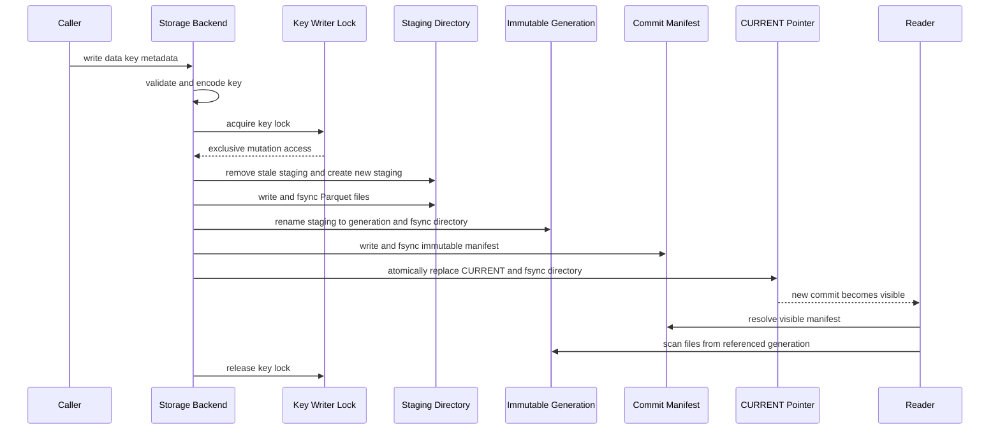

# Storage, Atomic Generations, and Metadata

The storage subsystem turns logical dataset keys into local Parquet data while preserving a common set of safety properties: keys cannot escape the configured root, readers see a coherent published version, metadata describes the same version as the data, and compatibility changes are explicit. The principal public factory, `create_storage(...)`, constructs either `HiveStorage` or `FlatStorage` from a frozen `StorageConfig`; both implement `StorageBackend`. `ChunkedStorage` is a separate `DataObject`-oriented layout with its own chunk index and locking model.

Storage is downstream of the time and identity rules described in [Data Time and Identity Contracts](../concepts/data-time-and-identity-contracts.md), and is normally reached through [Acquire, Validate, and Persist](../workflows/acquire-validate-and-persist.md) or [Incremental Updates and Gaps](../workflows/incremental-updates-and-gaps.md).

## Entry points and contracts

`StorageBackend` defines the synchronous key/value contract used by Hive and flat storage:

- `write(data, key, metadata=None, preserve_metadata=False) -> Path`
- `read(key, start_date=None, end_date=None, columns=None) -> pl.LazyFrame`
- `list_keys()`, `exists(key)`, and `delete(key)`
- `get_metadata(key)` for the metadata belonging to the visible commit

`create_storage(base_path, strategy=...)` is the normal constructor. Passing a complete `StorageConfig` forbids additional strategy/options, avoiding two competing configuration sources. Hive is the default strategy. Compression, lock timeout, metadata tracking, and Hive partition granularity are canonicalized by `StorageConfig`.

`IncrementalStorageBackend` is a runtime-checkable structural protocol rather than another base class. It describes the extra operations expected by update workflows: latest timestamp lookup, audit-chunk saving, combined-file replacement, filtered eager reads, and update-history metadata. `HiveStorage` supplies these methods. In particular, `update_combined_file` reads the current dataset, aligns schemas, concatenates, keeps the latest row per `timestamp`, sorts, and republishes the whole logical key.

> **Configuration boundary:** a default data root comes only from the shared `ml4t.data.core.config.resolve_data_root()` helper. Explicit caller paths take precedence. Storage code must not introduce hard-coded home directories or a second defaulting policy; see [Configuration and CLI](../operations/configuration-and-cli.md).

## Logical keys are not paths

All layouts treat a key as a logical identifier. `validate_storage_key` requires a non-empty UTF-8 string of at most 160 bytes, rejects leading/trailing separators, backslashes, control characters, and empty, `.` or `..` components. `encode_storage_key` then applies canonical URL-safe base64 with a `k1_` prefix, producing one portable filename component. Consequently, keys such as `a/b_c` and `a_b/c` remain distinct instead of being flattened ambiguously.

`contained_path(root, ...)` resolves both root and candidate and rejects a candidate that leaves the root. This also prevents a pre-existing symlink such as `.metadata` or `.trash` from redirecting locks or deletion outside the configured tree. Human-readable components, including backup and snapshot names, have additional cross-platform checks for absolute paths, separators, Windows stream syntax and reserved filenames.

The encoded directory name is an implementation detail. Call `list_keys()`, `partitions()`, or another backend API rather than deriving physical paths from a logical key.

## Hive and flat: one publication protocol

For Hive and flat storage, each encoded key directory has this conceptual shape:

```text
k1_<encoded-key>/
  CURRENT
  commits/
    <commit-id>.json
  generations/
    <generation-id>/
      data.parquet                     # flat, or empty Hive data
      year=2025/month=01/data.parquet  # Hive example
```

A generation is immutable after publication. A commit manifest is also immutable and binds one generation identifier to one metadata object. `CURRENT` contains the single commit identifier visible to new readers. Data and metadata therefore change together at the pointer swap rather than through separate mutable files.

### Write and visibility sequence



*One key lock serializes staging and publication, while the atomic `CURRENT` replacement is the reader-visible commit point.*

The backend acquires a per-key `FileLock` under `.metadata` before preserving metadata, cleaning stale `.staging-*` directories, or creating a generation. Each Parquet file is written to a temporary sibling, flushed with `fsync`, renamed into place, and followed by a directory flush where supported. Once staging is complete, the directory is renamed into `generations/<generation-id>`. The backend writes and flushes a new JSON commit manifest, then atomically replaces and flushes `CURRENT`.

A failure before the `CURRENT` replacement leaves the previous commit visible. Failed staging is removed by the writer; staging left by a crashed process is recovered by the next writer **under the same key lock**, not by backend construction. A pointer-publication failure may leave an unreferenced generation and manifest, but does not expose a mixed dataset. History pruning is best-effort after publication and retains the current and recent manifests/generations, bounded by `GENERATION_RETENTION` (currently three).

Readers do not take the writer lock. They resolve `CURRENT`, validate its 32-character lowercase hexadecimal identifier, parse and validate the commit manifest, and require the referenced generation directory. If the current manifest is invalid, `_current_commit` searches retained manifests newest-first and uses the first prior valid generation; if none is valid, the corruption is surfaced as `RuntimeError`. `exists` means a resolvable published key is present, while deletion first renames the whole key directory into contained `.trash` under lock—making it inaccessible—then removes it outside the lock.

## Layout-specific behavior

### Flat Parquet

`FlatStorage` writes one `data.parquet` per generation. Every `write` is a full replacement, not an append. A read resolves one commit and returns `pl.scan_parquet(...)`; time filtering is applied before optional projection so callers may filter by a timestamp column they do not request in the final result.

### Hive Parquet

`HiveStorage` materializes the input once to derive configured partition columns, then writes one Parquet file per time group. Granularity maps to `year`, `year/month`, `year/month/day`, or `year/month/day/hour` (month is the default). A repeated write is also a full generation replacement: partitions absent from the new frame disappear from the newly visible dataset.

Reads first enumerate the published generation's partition files, order them by numeric partition values, prune partitions against the requested range, and create Polars scans only for relevant files. Exact timestamp predicates are still applied within each selected partition. Multiple scans are combined with `vertical_relaxed`; reads remain lazy. `partitions(...)` exposes stable descriptive objects—values, size, label, and current file path—without asking callers to parse generation directories.

Both backends preserve empty datasets. Flat writes an empty `data.parquet`; Hive writes one at the generation root when there are no partition groups, retaining schema for a lazy empty read.

### Chunked Parquet

`ChunkedStorage` is intentionally different from `StorageBackend`. It accepts a `DataObject`, derives the canonical three-part key `asset_class/frequency/symbol`, splits rows into calendar-aligned weekly, monthly, quarterly, or yearly chunks, and keeps a version-2 JSON index containing typed metadata and `ChunkInfo` records. Updating an existing chunk aligns schemas, concatenates old and new rows, deduplicates `timestamp` with the new row winning, sorts, and atomically replaces that chunk. Unchanged index entries are retained.

Chunk files and the index use file locks and atomic temporary-file replacement, but chunk publication is not the immutable-generation/`CURRENT` transaction used by Hive and flat. Readers eagerly load relevant chunks into a `DataObject`, use an exclusive end bound, and reconstruct old metadata from a three-part key only when the index has no stored metadata. Treat this as a distinct consistency model: do not claim that a multi-chunk update is visible through one generation pointer.

## Metadata has three roles

### Commit metadata

With `metadata_tracking=True`, Hive and flat commit records include operational facts such as `last_updated`, `row_count`, schema, and either partition names or flat-file details. Caller metadata is nested under `custom`. With tracking disabled, the committed metadata object is empty, though publication remains atomic.

`preserve_metadata=True` merges the current commit's `custom` block while holding the writer lock. New top-level custom values win, and nested `attributes` dictionaries are merged. A missing or unreadable prior record does not prevent a replacement write; the supplied metadata becomes the effective metadata.

`normalize_storage_metadata(...)` is the compatibility boundary for consumers and migration code. It flattens canonical or legacy records, gives non-null `custom` values precedence without allowing null to erase a non-null committed value, can infer `asset_class/frequency/symbol` from a three-part key, and can derive frequency from `bar_params`.

### Operational update tracking

`MetadataTracker` is separate from commit metadata. It stores a per-key `DatasetMetadata` status file and a bounded history of `UpdateRecord` events under `.metadata`, using encoded key filenames and file locks. It records row/date ranges, provider, counts, duration, gap fills and errors; history is capped at 100. Health checks classify missing metadata as error, old or lagging daily data as stale, and repeated recent errors as error. This tracking is an operational view and does not replace the commit manifest as the authoritative data/metadata publication unit.

The incremental Hive helper also maintains an `update_history` inside dataset metadata and caps it at 100. `_update_metadata` publishes a new commit that references the existing immutable generation, so a metadata-only change still has an atomic commit point.

## Portable immutable snapshots

`export_snapshot(...)` creates a verified, relocatable copy of explicitly declared input tables. A `SnapshotTable` may wrap a frame or a `StorageBackend` plus logical key. For backend sources, capture holds the source key's actual writer lock while resolving one commit and copying exactly its declared Parquet members. This prevents generation pruning or a concurrent publication from changing the source during capture.

Snapshot declarations must include source revision, identity namespace, units, `as_of`, price basis, share basis, and revisions. Values must be finite portable JSON; machine-local paths and credential-like fields or credential-bearing URLs are rejected. The manifest records table role, metadata, clock/calendar resolution, schema, row count, per-file SHA-256, effective consumer configuration, artifact hashes, software versions, and source capture commit/generation for audit.

Export occurs in a locked sibling staging directory. After files and the canonical manifest are written, `read_snapshot` verifies the staged result, directories are flushed, and staging is renamed to the destination. An existing destination is accepted only if it has the same content-derived `snapshot_id`; a different valid snapshot is never overwritten. The identity hashes content and declarations, not capture time or source generation IDs.

On read, the manifest checksum and content identity are checked first, member paths must be canonical and symlink-free, and **all file hashes are verified before any table is parsed**. Only then are Parquet frames loaded and checked against declared schema and row count. Because the snapshot owns copied bytes rather than generation references, it survives source history pruning and relocation.

## Migrations and compatibility

Layout compatibility changes require explicit migrations. Current backends detect old unencoded flat files, Hive directories, and chunk indexes and warn; they do not silently reinterpret them as current keys.

`find_legacy_storage_entries(...)` inventories the ambiguous pre-0.1 layout without guessing logical names. `migrate_legacy_storage(...)` requires an exact physical-to-logical key mapping, rejects duplicate or invalid destinations and existing targets, writes through the selected current backend, reads the result back, and compares it with the source. Only after every destination verifies are legacy files moved beneath `.legacy-v0-backup`. Write or backup failures attempt to remove destinations and restore moved sources, and incomplete rollback is reported as `LegacyStorageMigrationError`.

`MigrationManager` is the separate schema-migration framework: registered versions transform every Parquet file, record status under `.migrations/migration_state.json`, stop on the first failure, support dry runs, and only roll back migrations that provide a downgrade function. It does not make arbitrary in-place transforms atomic across all files, so operators should pair schema migrations with an appropriate backup/snapshot plan.

## Shared invariants and safe extension points

A new backend or layout change should preserve these properties:

1. **One key meaning:** validate and canonically encode every caller-controlled key; never concatenate it into paths directly.
2. **Root containment:** all special directories, locks, temporary files, backups, and deletion targets remain below the configured root even in the presence of symlinks.
3. **Coherent visibility:** for `StorageBackend`, data and metadata become visible through one atomically replaced commit pointer; failed writes leave the previous publication readable.
4. **Immutable published bytes:** do not mutate a generation after publishing it. Metadata-only updates create a new commit referencing the old generation.
5. **Lazy backend reads:** Hive and flat return `pl.LazyFrame`, apply time predicates before projection, and retain correct empty-schema behavior.
6. **Explicit compatibility:** never change key encoding, physical layout, partition meaning, index version, or metadata interpretation silently. Add an inventory/verification migration and tests.
7. **Shared defaults:** obtain default data roots only from shared configuration helpers; honor explicit paths and normalize them once.
8. **Failure cleanup:** temporary and staging artifacts are cleaned without deleting another active writer's state; durability-sensitive replacements flush the writable producer and containing directory where supported.

Focused regression coverage lives in `tests/test_storage_backends.py` for key safety, coherent concurrent data/metadata, failure preservation, fallback and bounded history; `tests/test_portable_snapshot.py` for immutable capture, hashes, portability, credential/path rejection and source locking; and `tests/test_acquisition_atomic_flush.py` for writable-handle flushing before atomic replacement on Windows-like semantics.
