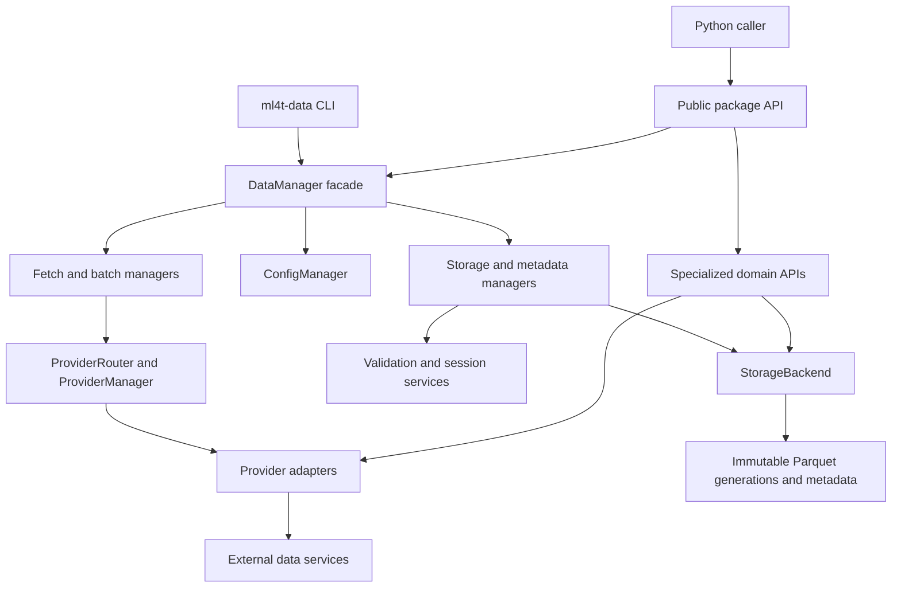

# System Architecture and Ownership Boundaries

`ml4t.data` is a layered market-data package rather than one monolithic client. Its supported package API exposes stable contracts such as `DataManager`, `BaseProvider`, `Config`, asset and futures contract specifications, and `ProviderRoutingError`; optional imports are guarded so a missing provider extra does not make the base package unusable. `DataManager` is the preferred general-purpose facade, but it deliberately delegates work to focused managers and does not absorb specialized futures, COT, anomaly, or synthetic-domain logic.

*Principal runtime boundaries and the downward dependency direction from entrypoints to external services and persisted generations.*

## Responsibility map

| Boundary | Owns | Does not own |
|---|---|---|
| Public package API | Stable imports and lightweight contract discovery | Eager loading of every optional provider |
| `DataManager` | Facade construction, API compatibility, and delegation | Provider-specific HTTP behavior or physical persistence |
| Focused managers | Configuration, routing, fetching, batching, storage workflows, metadata discovery, and bulk coordination | Domain-specific remote protocols |
| Provider system | Registry metadata, availability, credentials, adapter lifecycle, retries, rate limits, connection sessions, and canonical provider output | Durable local storage and update policy |
| Validation and sessions | OHLCV/cross-data diagnostics and exchange-calendar interpretation | Provider routing or filesystem publication |
| Storage | Logical keys, lazy reads, Parquet layout, metadata, locking, atomic generation publication, and retention | Choosing what market data to fetch |
| Specialized domains | Domain semantics such as futures symbols, rolls, adjustments, and dedicated acquisition workflows | The generic provider registry and generic storage contract |
| CLI | User interaction, command registration, argument/file handling, and presentation | A second implementation of acquisition or persistence rules |

This separation is an important change rule: shared provider, manager, model, or storage contracts affect multiple adapters and consumers, while domain-only behavior should remain in its domain package. See [Data Manager Runtime](data-manager-runtime.md), [Storage and Metadata](storage-and-metadata.md), [Data, Time, and Identity Contracts](../concepts/data-time-and-identity-contracts.md), and [Provider System](../integrations/provider-system.md) for the narrower contracts.

## General acquisition path

Construction of `DataManager` establishes the runtime graph:

1. `ConfigManager` resolves built-in defaults, a typed YAML file, credential environment variables, and runtime overrides, in increasing precedence. It validates provider overrides and limits output formats to `polars`, `pandas`, or `lazy`.
2. `ProviderRouter` receives configured regular-expression routes and, only when no routes are configured, installs conservative defaults for unambiguous OANDA forex symbols and Databento continuous-futures symbols. Bare tickers and compact pairs are intentionally not guessed.
3. `ProviderManager` lazily loads registry-declared, manager-compatible classes, detects whether constructor requirements are configured, and caches instantiated providers for connection reuse.
4. `FetchManager` validates `YYYY-MM-DD` ranges, resolves an explicit provider override or route, checks the provider's `ohlcv` capability, invokes `fetch_ohlcv`, and converts the resulting Polars frame when requested.
5. `BatchManager`, `StorageManager`, `MetadataManager`, and `BulkManager` are wired around that fetch path as needed. Storage and bulk managers exist only when a backend is supplied.

Routing is fail-closed. A single fetch raises `ProviderRoutingError` if neither an override nor a unique pattern applies. Sequential `fetch_batch` validates every symbol's route before making any provider request; after routing succeeds, individual fetch failures are represented by `None`. The parallel batch API is owned separately by `BatchManager`.

Providers own network mechanics and source adaptation. `BaseProvider` composes rate limiting, a circuit breaker, HTTP-session lifecycle, normalization, and validation; its template fetch validates inputs, acquires a rate-limit slot, executes provider-specific transformation, and returns canonical OHLCV data. The shared retry policy retries retryable network failures up to three attempts with exponential backoff and honors bounded `Retry-After` hints. Registry `ProviderSpec` metadata is the authority for capabilities, credentials, extras, and whether a provider can participate in `DataManager`; direct-API-only factor, event, tick, macro, or synthetic providers remain discoverable without being forced through an OHLCV facade.

`DataManager` is also a resource owner. Provider instances live until `clear_cache()` or context-manager exit, at which point route decisions are cleared, providers with `close()` are closed, and the instance cache is emptied.

## Ingestion, validation, and persistence

Supplying a `StorageBackend` enables `load`, `import_data`, `update`, metadata discovery, and bulk update methods. Calls without a configured backend fail explicitly rather than silently becoming fetch-only operations.

For an initial load, `StorageManager`:

1. reconciles the requested frequency, bar type, calendar, and optional `FeedSpec`;
2. fetches a raw Polars frame and rejects an empty result;
3. optionally runs asset-class OHLCV and cross-validation rules;
4. constructs `Metadata` and a schema-checked `DataObject`;
5. writes the logical key `asset_class/frequency/symbol` through the backend.

Validation is diagnostic in this workflow: a failed report is logged with severity counts, but does not itself veto the write. Structural contracts are stricter. `DataObject` requires `timestamp`, OHLC, and `volume`, requires a datetime timestamp and numeric market columns, while `Metadata` normalizes and serializes the shared time declaration. Import similarly rejects missing required columns before publication.

Incremental update is replacement-oriented, not append-in-place. If the key is absent, update becomes an initial load, respecting the provider's declared history bound. Otherwise it reads the current generation, uses stored provider and temporal metadata when no override is supplied, refetches an overlapping lookback window, aligns schemas, concatenates, keeps the last row for each duplicate timestamp, sorts, and writes the complete merged frame with preserved metadata. Gap checks report missing calendar observations; `fill_gaps=True` is rejected because the manager does not invent prices or volume.

Physical atomicity belongs to `StorageBackend`, not the manager. Both Hive and flat strategies stage a new immutable generation under a per-key lock, publish its commit metadata, and atomically replace the `CURRENT` pointer. Readers resolve one complete commit and can fall back to a prior valid retained commit if the current manifest is damaged. This means callers should reason about each `write` as complete-generation replacement. `create_storage()` selects `HiveStorage` by default or `FlatStorage` from one canonical `StorageConfig`.

## Time and session semantics

Calendar behavior is an explicit data contract, not something inferred from a descriptive exchange string in generic code. `Metadata` carries calendar, timezone, timestamp semantics, bar grid/label, partial-bar policy, and a versioned time contract. Storage ingestion checks that a supplied feed's physical frequency and bar type agree with the requested operation and instantiates `SessionAssigner` to validate the declaration.

`MetadataManager` exposes session services even when `DataManager` has no storage backend. `assign_sessions` maps daily labels or intraday instants to `session_date` using `FeedSpec` and a registered market calendar. An explicit `calendar=None` disables session handling; conflicting selectors, unknown exchanges/calendars, invalid timezones, and unsupported custom session-start overrides fail early. `complete_sessions` may expand a minute grid with null placeholders and an `is_imputed` marker, but it rejects value-filling modes and zero-volume fabrication. Thus “completion” exposes absence rather than manufacturing market observations.

## Specialized market-data domains

Some market data needs richer semantics than `symbol + date range + OHLCV`. The futures package therefore owns contract schemas and definitions, parent/individual/continuous symbol distinctions, Databento parsing and downloads, roll selection, adjustment methods, and continuous-contract construction. It may consume provider or storage facilities, but these concepts do not move into the generic registry or backend. Databento-backed downloader exports remain optional: non-Databento futures tools import normally, while attempting to use a downloader without the extra produces an actionable installation error.

The same architectural principle applies to `cot/`, `macro/`, `crypto/`, `etfs/`, `anomaly/`, and `synthetic/`: put domain-specific parsing, models, and workflows there; expose a provider through `DataManager` only when its registry contract is manager-compatible and matches the general capability being invoked.

## CLI boundary

The `ml4t-data` console script enters through `ml4t.data.cli_interface:cli`. `cli_interface.py` is a compatibility re-export; command ownership lives in the modular `cli` package:

- `cli/core.py` registers fetch, update, validate, status, export, info, and list operations;
- `cli/batch.py` owns `update-all`;
- `cli/futures.py` and `cli/cot.py` expose specialized workflows;
- `cli/config.py` owns version, provider, configuration, and shell-completion inspection;
- `cli/utils.py` owns presentation, input validation, progress, and file saving.

The CLI should remain an adapter: reusable behavior belongs in managers, providers, storage, validation/session services, or a specialized domain API. This keeps Python and command-line behavior on the same underlying contracts.

## Extension and operational guidance

- **Add a general provider:** define registry metadata and an adapter that satisfies the capability contract. Keep optional dependencies import-isolated, declare credentials/extras, and test both configured and unavailable states. A custom runtime class can be registered on `ProviderManager`, but durable built-in discovery belongs in the registry.
- **Add a storage strategy:** implement the `StorageBackend` protocol and preserve contained paths, per-key mutation locking, complete-generation publication, metadata behavior, lazy reads, and logical-key identity. Then extend `create_storage()` deliberately.
- **Change time semantics:** update the shared `FeedSpec`/metadata/session consumers together. Do not add a second calendar inference convention in a provider or CLI command.
- **Operate fetch-only:** construct `DataManager()` and specify a provider where a symbol is ambiguous.
- **Operate with persistence:** construct a backend with `create_storage(...)` or `StorageConfig`, pass it to `DataManager(storage=...)`, and use context-manager scope when provider connections should close deterministically.
- **Treat validation warnings consciously:** enabling validation provides diagnostics during ingestion; downstream policy must decide whether warning/error counts are acceptable because manager ingestion still publishes structurally valid data.

## Focused verification

Tests are organized around boundaries rather than only end-to-end commands:

- `uv run pytest tests/test_data_manager_unit.py -q` covers configuration merging, route caching, date/output handling, provider detection, and preflight batch routing.
- `uv run pytest tests/test_data_manager_storage.py tests/test_storage_backends.py -q` covers facade-to-storage workflows, both backend strategies, metadata preservation, path containment, replacement writes, and concurrency/atomicity behavior.
- `uv run pytest tests/test_sessions.py tests/test_session_calendar_contract.py tests/test_daily_session_gaps.py -q` covers calendar and timestamp semantics.
- `uv run pytest tests/futures -q -ra` is the focused lane for futures symbology, boundary dates, rolls, adjustments, and optional Databento behavior.

When a shared model, provider contract, manager flow, or storage protocol changes, run tests for adapters, orchestration, and persistence consumers together; each layer relies on the others' contract while retaining its own implementation ownership.
