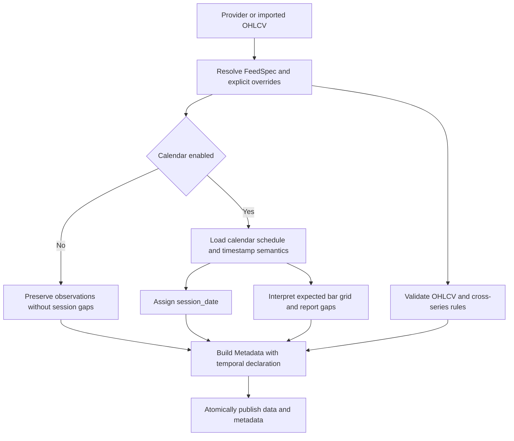

# Data, Time, Session, and Identity Contracts

The data subsystem has several related contracts rather than one universal table type. A provider-facing single-asset bar table, a stacked multi-asset table, persisted metadata, and a dated instrument registry serve different purposes. The shared `FeedSpec` declaration is the bridge: it gives column roles and timestamps an explicit meaning so session assignment, gap detection, updates, adjustments, and storage do not have to infer semantics from a symbol or an exchange description.

## Canonical data shapes

### Single-asset OHLCV

`DataObject` is the persisted single-asset boundary. Its frame must contain:

| Column | Contract |
| --- | --- |
| `timestamp` | Any Polars `Datetime`; a `Date`, string, or integer is rejected here |
| `open`, `high`, `low`, `close`, `volume` | Numeric (`Float64`, `Float32`, `Int64`, or `Int32`) |

`DataObject.to_canonical_schema()` casts timestamps and numeric values, adds absent `dividends=0.0` and `splits=1.0`, and returns the core columns followed by those two optional corporate-action columns. This canonicalizer deliberately drops unrelated extra columns. Import and load workflows also call `timestamp_bounds`, which rejects non-`Datetime`, empty, or all-null timestamp columns before constructing metadata.

`AssetSchema` is a broader provider/asset-class validation layer, not a replacement for `DataObject`. Equity and crypto bars require all six OHLCV fields; forex, commodity, and index data can omit volume; options use a distinct quote/Greek shape. Its validator reports missing or incompatible fields, while `normalize_dataframe()` attempts casts and inserts missing required fields as nulls. Callers therefore must not treat normalization as proof that observations are usable.

### Stacked multi-asset bars

`MultiAssetSchema` adds a required `symbol` to the OHLCV shape. Its declared storage schema is `timestamp: Datetime(us, UTC)`, `symbol: Utf8`, and `Float64` OHLCV. Validation is intentionally compatibility-oriented: any `Datetime`, numeric OHLCV widths, and `Utf8` or categorical symbols pass. Use `cast_to_schema()` when the exact declared types are needed, and `standardize_order()` to order core columns and sort by `[timestamp, symbol]`.

Optional fields are asset-specific: equities add distributions and adjusted close, crypto adds trade-count/taker volumes, futures add open interest, and options add open interest plus selected Greeks. `add_symbol_column()` is idempotent only when every existing value equals the requested symbol; conflicting or mixed symbols fail instead of being overwritten.

### Safe concatenation and update merging

`align_frames_for_concat()` forms the union of both column sets, casts both sides to a common schema, and inserts typed nulls unless the caller supplies fill values. Datetime reconciliation preserves the finer precision; differing timezone-aware types normalize to UTC rather than discarding timezone information. Incremental storage merges use this helper with corporate-action defaults (`dividends=0.0`, `splits=1.0`), then concatenate, retain the last row per `timestamp`, and sort. This update merge is therefore a **single-series** contract: it does not deduplicate by `(symbol, timestamp)`.

## Feed and timestamp declaration

`FeedSpec` comes from the `ml4t-specs` dependency and is consumed through `resolve_feed_spec()` or `FeedSpec.from_any()`. The receiving helper rejects contradictory aliases in mapping input and rejects explicit `timestamp_col`, `entity_col`, or `price_col` overrides that disagree with a supplied declaration. Important roles and temporal fields include:

- `timestamp_col`, `entity_col`, and `price_col`: source column roles; these allow dated history and actions to retain native names while normalized outputs add stable keys.
- `data_frequency` and `bar_type`: the physical cadence and whether bars are fixed-time or event-count based.
- `calendar`: an explicit schedule name, explicit `None`, or an omitted/unset value.
- `timezone`: the civil timezone used to interpret naive timestamps and session-label dates.
- `timestamp_semantics`: `session_label`, `event_time`, or `bar_close`.
- `bar_grid_anchor`, `bar_label`, and `partial_bar_policy`: the grid required to interpret intraday absences.
- `time_contract_version`: controls, among other compatibility behavior, whether explicit calendar disablement is distinguishable from legacy absence.

Do not infer these values from `Metadata.exchange`. `exchange` remains descriptive metadata; calendar selection is explicit, with a small compatibility mapping only when callers deliberately pass the `exchange` selector to session APIs.

### Calendar presence is semantically significant

For version 2 declarations, `calendar=None` means “disable schedule-aware behavior,” while an omitted calendar remains omitted and can resolve through compatibility defaults such as NYSE. `Metadata` preserves this distinction through Pydantic and JSON/YAML serialization by retaining the `UNSET_CALENDAR` sentinel internally and removing an omitted calendar from serialized output. An explicit calendar argument overrides the declaration; contradictory selectors fail.

Ingestion starts new declarations at time-contract version 2, verifies declared frequency and bar type against request arguments, validates the selected calendar before publication, and persists temporal fields into `Metadata`. Updates use stored metadata unless a new feed is supplied, preserve explicit disablement, and validate the effective declaration before replacing a storage generation. Invalid calendars or temporal metadata therefore leave an existing generation untouched.

*Feed declarations determine session and gap interpretation before validated observations and temporal metadata are published together.*

## Session labels and interval boundaries

`SessionAssigner` resolves one calendar and appends `session_date`; with calendar `None`, it returns the input unchanged. It requests calendar schedules with interruptions, subtracts breaks and halts from tradable intervals, and has special handling for CME Globex crypto trade-date schedules.

Daily labels and intraday instants follow different paths:

- Explicit `session_label` timestamps join by civil date. In the absence of explicit semantics, `Date`, declared daily frequency, or midnight-only timestamps can trigger the daily-label path; explicit event/close semantics override those heuristics.
- Naive intraday datetimes are localized using the declared timezone (UTC only when no timezone is declared), then compared in UTC. Invalid timezone names and ambiguous local clocks fail instead of silently changing meaning.
- Open/event-time or left-labeled bars use half-open intervals `[open, close)`. Close/right-labeled bars use `(open, close]`. Consequently a close timestamp belongs to the ending session for a close-labeled feed but is outside it for event-time semantics.
- Scheduled breaks and interruptions are excluded with the same boundary rules. One interrupted trading day still has one `session_date`, not one label per tradable interval.

The `outside_session` policy is explicit: `null` retains rows with a null label, `drop` removes them, and `raise` rejects the frame. A `Date` cannot represent declared `event_time` or `bar_close`. `session_start_time` is serializable but the native adapter raises `NotImplementedError` rather than pretending to alter a registered calendar.

## Completion and gaps are not imputation

`SessionCompleter` expands a **single-symbol, unique-timestamp, one-minute, open-labeled event-time** series onto scheduled minutes in a half-open requested range. Missing scheduled positions have null market values and `is_imputed=true`; the name marks a placeholder, not a fabricated observation. Synthetic prices and zero volume are prohibited. Duplicate timestamps, off-minute observations, observations during breaks, or observations outside the requested template fail. Calendar `None` is a no-op.

The native completer intentionally rejects non-time bars, non-minute declared frequencies, right/close labels, and general bar-grid policies it cannot implement. This is preferable to silently creating the wrong grid.

`GapDetector` provides the non-expanding alternative. A disabled calendar means no schedule gaps. Daily detection compares assigned session labels against the exchange schedule. Intraday detection requires a complete version-2 declaration—frequency, timestamp semantics, grid anchor, label side, and partial-bar policy—and rejects off-grid timestamps. Rows marked `is_imputed` are excluded from observed coverage. Incremental updates report counts in metadata but never fill gaps; the legacy `fill_gaps=True` option is rejected.

## Metadata contract

`Metadata` binds dataset identity (`provider`, `symbol`, `asset_class`), bar specification, temporal declaration, and observed date range. For time bars, `bar_params["frequency"]` is the physical frequency; non-time bars use a threshold and expose only a descriptive compatibility `frequency`. `data_frequency` deliberately returns `None` for non-time bars.

Storage metadata is operational state, not merely documentation. It is read back to choose providers, calendar behavior, gap checks, and update rules. Updates carry forward valid model fields, replace temporal fields with the effective declaration, refresh range and update timestamps, and record whether gap checking occurred and how many observations were missing. See [Storage and Metadata](../architecture/storage-and-metadata.md) and [Incremental Updates and Gaps](../workflows/incremental-updates-and-gaps.md).

## Stable instrument and contract identity

A market symbol is not a durable asset identifier. `InstrumentRegistry` accepts captured identity intervals with stable `asset`, `symbol`, `exchange`, `instrument_type`, `source`, `revision_id`, and `valid_from`; `valid_to` is optional and exclusive. It requires nonempty fields, supported instrument types, nonempty `[valid_from, valid_to)` ranges, and no overlaps either per stable asset or per `(symbol, exchange)`. Optional universe membership uses the same interval/revision model and may reference only declared assets.

Normalization resolves each source row at its observation date or instant. Symbol mode can use `exchange` to disambiguate symbol reuse; every row must match exactly once. A collision with an existing stable-ID output or internal key fails atomically. Date-valued identity intervals can be matched to intraday observations through declared session labels, which matters for overnight futures sessions. An `as_of` cutoff first selects revisions known at that time, so future price and identity revisions cannot rewrite a historical known-at result. `as_of=None` is explicitly retrospective.

After symbol normalization, native source columns remain intact and the stable asset column is added; output feed metadata changes `entity_col` to the stable asset while retaining the input feed declaration separately. This separation allows adjustment and continuous-contract workflows to join facts without erasing source provenance. See [Futures Continuous Contracts](../workflows/futures-continuous-contracts.md).

`ContractSpec` is a separate economic contract keyed by futures root symbol: it supplies asset class, point multiplier, minimum tick, optional margin, exchange, currency, and display name. `tick_value` is `multiplier * tick_size`. The built-in registry can be queried, copied selectively, or extended with `register_contract_spec()`. These values affect P&L and margin; they do not resolve dated listing identity or choose a calendar.

## Validation and extension rules

When adding a provider or transformation:

1. Emit provider data with a real `Datetime` and canonical OHLCV names before crossing `DataObject` or storage ingestion boundaries.
2. Declare native column roles and temporal meaning in `FeedSpec`; do not derive timestamp semantics from midnight values when the provider can state them.
3. Preserve omitted calendar versus explicit `None`, and pass the declaration through import, update, storage, and readback.
4. Use `align_frames_for_concat()` for schema evolution, supplying domain-safe fill values only where absence has a defined neutral value.
5. Use stable IDs plus dated identity intervals for history joins; never assume ticker uniqueness across venues or time.
6. Reject unsupported grids or identity ambiguity. Do not “helpfully” localize invalid zones, fill market prices, or infer a delisting from missing observations.

Focused regression coverage lives in [`tests/test_session_calendar_contract.py`](../../tests/test_session_calendar_contract.py), [`tests/test_ingestion_calendar_declarations.py`](../../tests/test_ingestion_calendar_declarations.py), and [`tests/test_history_identity.py`](../../tests/test_history_identity.py). Provider integrations should also preserve these contracts; see [Provider System](../integrations/provider-system.md).
