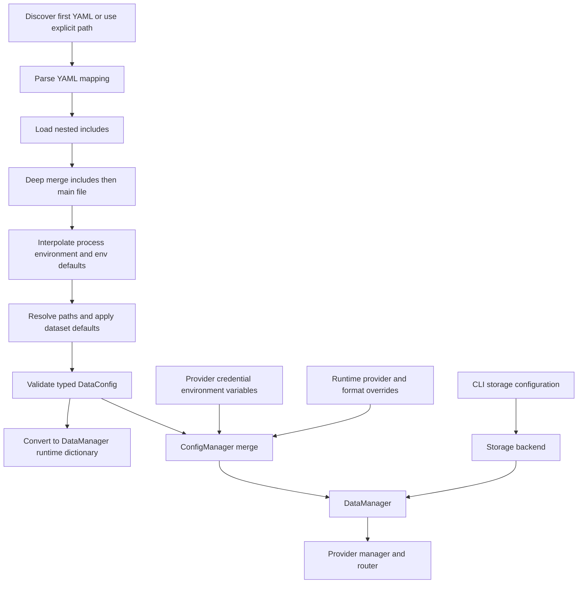

# Configuration Authority and CLI Operations

ML4T Data has one typed YAML boundary—`ConfigLoader` producing `DataConfig`—and a separate runtime merge boundary—`ConfigManager` producing the dictionary consumed by `DataManager`. Keeping those roles distinct matters operationally: loading a file validates its structure, while constructing a manager adds provider credential environment variables and call-site overrides. Storage is not implicitly created by `DataManager`; storage-oriented CLI commands construct a backend and pass it to the manager.

For the manager lifecycle behind these entrypoints, see [Data Manager Runtime](../architecture/data-manager-runtime.md). For storage keys and metadata, see [Storage and Metadata](../architecture/storage-and-metadata.md).

## Configuration discovery and loading

`ConfigLoader()` without an explicit path checks the following locations in order and uses the first existing file:

1. `./ml4t.data.yaml`
2. `./ml4t.data.yml`
3. `./.ml4t-data.yaml`
4. `./.ml4t-data.yml`
5. `./config/ml4t.data.yaml`
6. `~/.config/ml4t-data/config.yaml`

If none exists, the loader returns a default `DataConfig`. An explicit missing path is an error. In contrast, `DataManager(config_path=None)` does **not** perform this discovery: `ConfigManager` starts with runtime defaults. Pass `config_path` when the manager or CLI must use a particular YAML file.

The loader processes a file in this order:

1. Parse YAML with `yaml.safe_load`; the root must be a mapping.
2. Recursively process `include`. A string or list is accepted, relative include names are resolved from the including file, and missing includes produce warnings and are skipped. Includes are merged in listed order, then the including file is merged over them. Dictionaries merge recursively; lists are replaced rather than appended.
3. Interpolate `${NAME}` recursively in mappings and lists. `${NAME:default}` supplies a fallback. Process environment variables take precedence over values in the YAML `env` mapping; that mapping acts as defaults for interpolation. An unresolved reference remains unchanged and emits a warning.
4. Resolve `base_dir`, `storage.base_path` or the legacy `storage.path`, universe `file`, and dataset `symbols_file` paths. For the merged document these paths are normalized against the main configuration file's directory.
5. Apply the top-level `defaults` mapping to dataset fields that are absent.
6. Construct and validate `DataConfig`; validation failures become a `ValueError` whose diagnostics omit input values.



*Configuration flows from discovered YAML and includes through interpolation and typed validation, then provider environment and runtime overrides feed `DataManager`, while the CLI supplies configured storage separately.*

## Data path authority and compatibility

The authoritative data-root precedence is:

1. an explicit `data_root` argument;
2. `ML4T_DATA_PATH`;
3. deprecated `QLDM_DATA_ROOT`;
4. the project-local resolved path `./data`.

Paths are expanded for `~` and resolved. `QLDM_DATA_ROOT` remains compatible but emits a `DeprecationWarning`; if both environment variables are set, `ML4T_DATA_PATH` wins. `Config.base_dir` remains a read-only compatibility alias for `data_root`. `ML4T_DATA_LOG_LEVEL` can override the core `Config.log_level`.

This data-root policy is used by `DataConfig.base_dir` defaults and helpers such as COT's default `<data-root>/cot`. It should not be confused with core storage CLI fallback behavior: when `update`, `validate`, `status`, `export`, or `info` receives neither `--config` nor `--storage-path`, it explicitly opens `./data`; `list` requires one of those two options. With `--config`, those commands use the validated YAML storage section.

## Canonical schema, aliases, and validation

`DataConfig` rejects unknown fields and hides input values in Pydantic errors. Its major sections are `storage`, `providers`, `universes`, `datasets`, `workflows`, `defaults`, `env`, `routing`, and global logging/parallelism/validation settings.

The loader supports a narrow migration surface:

- `providers`, `universes`, `datasets`, and `workflows` may be mappings keyed by name; they normalize to canonical named-object lists. A provider mapping also defaults `type` to its key.
- top-level `api_keys` entries merge into matching providers or create a provider entry;
- `storage.path` normalizes to `storage.base_path`;
- dataset `start` and `end` normalize to `start_date` and `end_date`;
- `fx` normalizes to the `forex` asset class;
- a scalar or `(calls, period)` provider `rate_limit` normalizes to `RateLimitConfig`.

### Providers

Provider `type` is a case-normalized `ProviderType`, provider-specific options belong in `extra`, and structural or credential names are forbidden inside `extra`. The selected provider registry specification controls whether `api_key` and/or `api_secret` are accepted; credentials unsupported by that implementation are rejected. Rate limits require a positive request rate and burst size.

`DataConfig.to_runtime_dict()` changes provider lists into dictionaries keyed by configured provider name, carries only credentials recognized by the provider specification, and supplies runtime defaults for output format, frequency, and timezone. `ConfigManager` then applies known provider credential environment variables generated from the provider registry, followed by runtime `providers=...`, `output_format`, and recognized default-setting overrides. Runtime provider overrides are sent back through `DataConfig` validation rather than bypassing the typed boundary. The effective order is therefore built-in defaults < YAML < provider credential environment variables < runtime parameters.

### Datasets, workflows, and semantic checks

A dataset must identify symbols through `universe`, non-empty `symbols`, or `symbols_file`; its provider is required. Frequencies and asset classes are case-normalized. `update_mode` is `full` or `incremental`, lookback days cannot be negative, and initial load days must be positive. `fill_gaps: true` is rejected because synthetic imputation is unsupported; use `check_gaps` to report gaps. Workflow schedules enforce required fields for cron and interval schedules.

Pydantic construction enforces field-level shape and invariants. `ConfigValidator` is a separate, explicit semantic pass that checks duplicate names, provider/universe/dataset references, date order, schedule details, paths, and workflow error policy. It also reports non-fatal warnings for likely missing credentials, unused providers/datasets, missing base directories, and empty hooks. The CLI command named `validate` validates **stored market data**, not YAML configuration; loading through `load_config` does not automatically call `ConfigValidator.validate()`.

## Secret references and safe serialization

Use environment references for credentials:

```yaml
providers:
  - name: alpaca_main
    type: alpaca
    api_key: ${APCA_API_KEY_ID}
    api_secret: ${APCA_API_SECRET_KEY}
```

At runtime, interpolation makes the resolved value available to the provider. The model does not show credentials in its representation, and serialization excludes resolved or literal credential values. For a configuration loaded from YAML, `ConfigLoader` privately retains the original credential template—including embedded references such as `Bearer ${TOKEN}`—and writes that reference back only while the runtime value still corresponds to it. Reassigning the credential invalidates the retained reference instead of writing either the old reference or new literal. YAML writes use the secure serialization path and restrict file permissions to `0600` on POSIX systems.

Do not print, log, export, or document resolved credential values. Validation errors are deliberately generated without input payloads, and tests assert that environment-expanded canary secrets do not appear in exceptions or captured output.

## CLI entrypoint and command groups

The `ml4t-data` Click group stores global `--verbose` and `--quiet` flags in the command context. The legacy module `ml4t.data.cli_interface` re-exports `cli`, `main`, utilities, and several classes so older imports and patch points continue to work; new code should use the modular `ml4t.data.cli` package.

### Core data commands

| Command | Operational behavior |
| --- | --- |
| `fetch` | Accepts repeated `--symbol`, a symbols file, or a dataset selected from `--config`. Configuration can supply symbols/universe, dates, frequency, and provider; explicit CLI values win. A single symbol calls `DataManager.fetch`; multiple symbols prevalidate routes, fetch independently, retain partial successes, and optionally save one or many results. Results are materialized to Polars for display/output even if the configured manager format is Pandas or lazy Polars. |
| `update` | Resolves configured storage or `--storage-path`, builds the canonical `asset-class/frequency/symbol` key, and calls `DataManager.update` with lookback, gap-check, provider, and initial-load controls. Initial dates are rejected if the key already exists. See [Incremental Updates and Gaps](../workflows/incremental-updates-and-gaps.md). |
| `validate` | Reads one key or every stored key and checks required OHLCV schema, `high >= low`, and duplicate timestamps. Optional anomaly analysis filters by severity and may save a report. Any issue or anomaly causes exit status 1. |
| `export` | Reads an existing canonical key and writes collected data as CSV, JSON, or Parquet; missing or empty data is an error. |
| `status` | Uses metadata to classify keys as healthy, stale, or error and can render per-dataset details. Invalid/missing row counts are errors; observation age uses `end_date` then `last_updated`. |
| `info` / `list` | `info` combines stored rows with metadata for one key. `list` enumerates keys and metadata from either configured storage or an explicitly supplied storage directory. |

`--config` and `--storage-path` are mutually exclusive for storage commands. Configured storage construction honors strategy plus explicitly set compression, partition granularity, lock timeout, and metadata tracking. This is why operations against flat and Hive stores should use `--config` rather than assuming a directory layout.

### Batch updates

`update-all --config FILE` loads the canonical `DataConfig`, constructs its storage backend, and selects all datasets or one `--dataset`. Symbols come from inline values, the already-resolved `symbols_file`, or a referenced universe. Each symbol is sent to `DataManager.update` with the dataset's provider, frequency, asset class, lookback, gap checks, initial date bounds, and initial-load window. Failures are reported per symbol and do not stop later symbols. `--dry-run` resolves and displays the plan without updating.

### Futures workflows

The futures commands use the dedicated futures YAML loader and require the optional Databento integration:

- `download-futures --config FILE` loads a `FuturesDownloader`, permits product overrides, estimates cost, and supports dry runs. Normal execution confirms unless quiet, then downloads sequentially with continue-on-error or in parallel when `--parallel` is greater than one. Existing data is skipped unless `--force`.
- `update-futures --config FILE` finds the latest stored date and updates from the following day through `--end-date` or today. It reports no existing data rather than silently starting a full download, returns when already current, supports dry run, and confirms unless `--yes` or quiet.

Both commands report completed and failed products; configuration and integration failures abort the command.

### COT workflows

`download-cot` can list known CFTC products without downloading. Otherwise it either loads a COT config or requires one or more `--products`. CLI products, year bounds, and output path override corresponding loaded config fields by constructing a replacement config, so dataclass validation runs again. Unknown product codes abort.

Without a config, the defaults are start year 2020, current end year, and `resolve_storage_path(output, "cot")`, which means explicit `--output` first and otherwise the authoritative data root plus `cot`. A dry run displays the plan and existing products. Normal execution skips existing `product=<code>/data.parquet` files unless `--force`, fetches each product independently, writes non-empty results through `COTFetcher.save_to_hive`, and reports per-product errors.

## Failure and operating guidance

- Prefer explicit `--config` in repeatable jobs; discovery is convenient for library loading but is not performed by a default `DataManager`.
- Use `--dry-run` before costly batch, futures, or COT downloads.
- Treat a missing include as a warning that can silently remove expected settings; inspect startup logs in automated deployments.
- A malformed YAML document, non-mapping root, unknown typed field, unsupported provider credential, or invalid dataset invariant fails before provider construction.
- Multi-symbol fetch, batch update, futures, and COT workflows intentionally preserve/report partial results. Core single-operation failures abort with a non-zero exit.
- Use `ml4t-data providers` to see advertised providers and access requirements. `ml4t-data config` is only a simple current/default display; it is not a dump of merged typed configuration and never displays credentials.

For first-run examples, see the [Quickstart](../quickstart.md).
