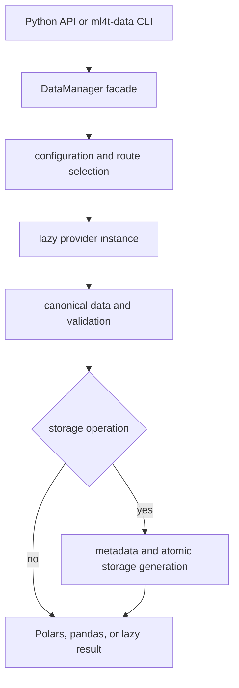

# Quickstart and Change Router

`ml4t-data` is the market-data boundary for ML4T applications: it acquires and validates data, persists local datasets, and incrementally keeps them current. It covers equities, futures, FX, crypto, macroeconomic series, factors, and prediction markets. The distribution is `ml4t-data`; the Python package is `ml4t.data`; supported runtimes are CPython 3.12–3.14.

## Start from a supported entry point

Choose the narrowest public surface that fits the request:

- **One provider, no persistence:** import a provider from `ml4t.data.providers` and call its documented API. `SyntheticProvider(seed=42)` is the deterministic, credential-free reference path for OHLCV work.
- **Routing, multiple providers, or managed datasets:** use `DataManager` from `ml4t.data`. It is a facade: fetches delegate to routing/provider/fetch managers, while storage-backed load, import, update, metadata, and bulk operations are enabled only when a storage backend is supplied.
- **Operations and automation:** run the installed `ml4t-data` command. Its Click command group exposes fetch, update, validation, status, export, listing, batch update, futures, COT, provider, and configuration commands. `ml4t.data.cli_interface` remains the console-script target and compatibility re-export; command implementations belong under `ml4t.data.cli`.
- **Contracts or specialist capabilities:** use documented subpackages such as `ml4t.data.storage`, `ml4t.data.futures`, and `ml4t.data.validation`; do not reach through a facade merely to call its private delegate.

A minimal offline smoke path is:

```python
from ml4t.data.providers import SyntheticProvider

provider = SyntheticProvider(seed=42)
data = provider.fetch_ohlcv("SYNTH", "2024-01-01", "2024-01-10", "daily")
```

For development, create the complete locked environment before diagnosing missing optional integrations:

```bash
uv sync --locked --all-extras --all-groups
```

## How a managed request moves



*The managed path separates user entry points, orchestration, provider I/O, canonical contracts, and optional persistence.*

Read [System Architecture and Ownership Boundaries](architecture/system-overview.md) before changing a boundary, and [DataManager Runtime and Delegated Managers](architecture/data-manager-runtime.md) before changing facade behavior, routing, provider caching, or cleanup. The important design cue is delegation: a new behavior should normally be implemented by the component that owns it, not accumulated in `DataManager` or the CLI.

## Repository-wide invariants

These constraints apply even when a local change appears self-contained:

1. **Preserve the PEP 420 namespace.** `src/ml4t/` deliberately has no `__init__.py`; wheel configuration declares namespace packaging. Never add `src/ml4t/__init__.py`. Test export changes against an installed wheel, not only the source checkout.
2. **Isolate optional providers.** The base package must import without every provider SDK, credentials, or network access. Provider discovery metadata can be inspected without importing implementations, and implementations are loaded lazily from registry specifications. Keep extras and failure messages provider-specific; do not make an unrelated adapter a core import dependency.
3. **Use one data-root authority.** Resolve paths through `ml4t.data.core.config`. Precedence is explicit argument, `ML4T_DATA_PATH`, deprecated `QLDM_DATA_ROOT` with a warning, then `./data` under the current working directory. Do not introduce another environment variable, home-directory default, or ad hoc path expansion.
4. **Keep default tests offline and deterministic.** Pytest excludes `slow`, `paid_tier`, `integration`, and `requires_api_key` tests by default. An autouse guard rejects external DNS and socket access in unmarked tests; loopback remains available. Mock transports for normal tests and use an established marker only for a genuinely live, credentialed, paid, or slow lane.
5. **Respect shared contracts.** Providers should emit canonical data and use shared exceptions, retry, rate-limit, session, validation, and storage contracts. A protocol/model change is cross-cutting: verify its provider, orchestration, and persistence consumers.
6. **Treat persisted replacement as atomic.** Supported storage paths publish complete immutable generations. Do not revive removed transaction switches or write partial in-place replacements.
7. **Close owned resources.** A `DataManager` context exit clears route cache and closes cached provider connections. Tests also reset process-global provider/rate-limit state; changes that add global state need equivalent isolation.

## Route a change by task

| Requested change | Read first | Then follow the behavior |
|---|---|---|
| Change a public API, ownership boundary, or package-level interaction | [System Architecture and Ownership Boundaries](architecture/system-overview.md) | [DataManager Runtime and Delegated Managers](architecture/data-manager-runtime.md) for facade/delegate lifecycle |
| Change `DataManager` fetch, batch behavior, routing, caching, storage enablement, or cleanup | [DataManager Runtime and Delegated Managers](architecture/data-manager-runtime.md) | [Provider Contracts, Registry, and External Integrations](integrations/provider-system.md) for provider-side effects |
| Add or modify an initial acquisition or external import | [Acquire, Validate, and Persist Data](workflows/acquire-validate-and-persist.md) | [Data, Time, Session, and Identity Contracts](concepts/data-time-and-identity-contracts.md), then storage |
| Change incremental updates, overlap, deduplication, gaps, or backfill | [Incremental Updates, Gap Detection, and Backfill](workflows/incremental-updates-and-gaps.md) | [Data, Time, Session, and Identity Contracts](concepts/data-time-and-identity-contracts.md) for calendar/feed semantics |
| Change keys, paths, metadata, Parquet layout, locking, snapshots, or migrations | [Storage, Atomic Generations, and Metadata](architecture/storage-and-metadata.md) | [Configuration Authority and CLI Operations](operations/configuration-and-cli.md) for root/path precedence |
| Add or change a provider, credential, capability, alias, HTTP policy, retry, rate limit, or circuit breaker | [Provider Contracts, Registry, and External Integrations](integrations/provider-system.md) | Acquisition/update workflows according to whether the provider participates in managed routing |
| Change OHLCV schema, timestamps, feeds, sessions, calendars, asset identity, or contract identity | [Data, Time, Session, and Identity Contracts](concepts/data-time-and-identity-contracts.md) | Recheck providers, validation, update merge behavior, and persisted metadata |
| Change futures download, symbols, contract selection, rolls, or adjustments | [Futures Acquisition and Continuous Contracts](workflows/futures-continuous-contracts.md) | Provider and storage pages for integration and publication boundaries |
| Change YAML loading, includes, interpolation, environment variables, secrets, defaults, or a CLI command | [Configuration Authority and CLI Operations](operations/configuration-and-cli.md) | The architecture/workflow page for the operation the command invokes |
| Add tests, select a marker, alter CI, packaging, compatibility, docs, or release behavior | [Testing Strategy, CI Lanes, and Release Gates](testing/test-strategy-and-quality-gates.md) | The affected subsystem page for focused contract suites |

The shortest safe investigation usually crosses three layers: **contract/owner → end-to-end workflow → focused tests**. For example, a provider output change starts with the provider contract, follows acquisition and incremental-update consumers, and ends in provider contract tests plus focused manager/storage tests. A CLI flag change starts with configuration/CLI ownership, then follows the command into the same Python workflow users can call directly.

## Verification strategy

Run the narrowest relevant tests while editing, then expand to repository gates. Common focused anchors are `tests/providers/` and `tests/test_*_provider.py` for adapters, `tests/test_data_manager*.py` for facade behavior, `tests/storage/` and `tests/test_*storage*.py` for persistence, `tests/futures/` for futures, and configuration/CLI tests for operational changes. The complete gate sequence is documented in [Testing Strategy, CI Lanes, and Release Gates](testing/test-strategy-and-quality-gates.md); the principal local checks are:

```bash
uv run ruff check src tests scripts
uv run ruff format --check src tests scripts
uv run ty check
uv run pytest tests -q -ra --cov=ml4t.data --cov-report=term-missing
uv run pytest tests -q -ra -W error::ResourceWarning
uv run mkdocs build --strict
uv build
```

Coverage is configured with an 85% floor. Packaging, provider-contract, compatibility, documentation, and release changes have additional workflow-specific checks; never weaken an offline guard or shared contract test to make an adapter pass. Release artifacts are qualified and published by automation from one commit, not by a local publish command.
