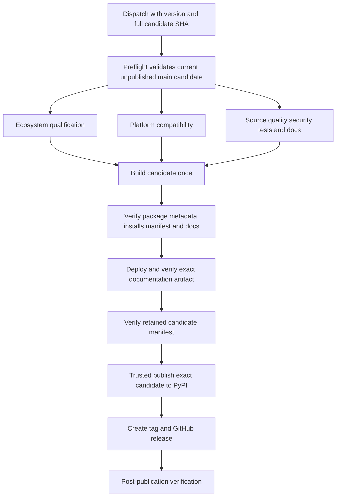

# Testing Strategy, CI Lanes, and Release Gates

The repository separates fast, deterministic evidence from tests that contact external services, need credentials, incur cost, or take unusually long. Treat that separation as a safety boundary: make the normal suite pass offline, select live tests deliberately, and never solve a failure by weakening markers or the network guard.

The usual change loop is:

1. install the locked environment;
2. run the smallest tests that exercise the changed contract;
3. run the complete local quality gates;
4. let CI repeat those checks across its lanes;
5. for a release, qualify one exact `main` commit and publish only the immutable artifact produced by the release workflow.

See [Quickstart](../quickstart.md) for package setup. Storage changes should also preserve the contracts in [Storage and Metadata](../architecture/storage-and-metadata.md); provider work belongs with [Provider System](../integrations/provider-system.md), and futures changes with [Futures Continuous Contracts](../workflows/futures-continuous-contracts.md).

## Install the test environment

The repository uses `uv`, Python 3.12 through 3.14, and a committed lock file. The broad developer environment matches the release quality job:

```bash
uv sync --locked --all-extras --all-groups
```

Pytest configuration lives in [`pyproject.toml`](../../pyproject.toml). Strict marker checking makes misspelled or undeclared markers an error, the default timeout is 300 seconds, and default parallelism is intentionally disabled because automatic worker execution has caused hangs. Coverage is measured over `src/ml4t/data`, with an enforced minimum of 85 percent.

## Test lanes and the offline invariant

A plain invocation such as `uv run pytest tests/test_storage.py -q` inherits the configured marker expression:

```text
not slow and not paid_tier and not integration and not requires_api_key
```

This is the deterministic default lane. The markers have distinct meanings:

| Marker | Meaning and selection policy |
| --- | --- |
| `integration` | The test may call a real external API. Run only as an explicit live lane. Every test collected below `tests/integration/` is marked this way automatically. |
| `requires_api_key` | The test needs a specific credential. Supply only that provider's secret and run a bounded target. |
| `paid_tier` | The endpoint requires paid access or may incur cost. It is excluded by default and must remain an intentional, authorized lane. |
| `slow` | The test is too slow for the ordinary edit loop. This marker does **not** grant network access. |
| `expensive` | The test has high API cost; integration configuration skips expensive integration cases in CI. |
| `network_guard_probe` | The test deliberately exercises the offline guard. It does not grant network access; it suppresses only the guard's duplicate teardown failure after the expected exception. |

The autouse `block_external_network` fixture in [`tests/conftest.py`](../../tests/conftest.py) enforces the boundary independently of marker selection. Unless a test has `integration`, `requires_api_key`, or `paid_tier`, it rejects external socket connections, `connect_ex`, and DNS resolution while permitting loopback. It also intercepts synchronous and asynchronous `curl_cffi` requests because yfinance's libcurl transport bypasses Python socket monkeypatches. A detected attempt raises immediately and is also reported at teardown. [`tests/test_offline_network_policy.py`](../../tests/test_offline_network_policy.py) proves rejection for sockets, DNS, and both curl transports, and proves that localhost remains usable.

Do not add a live marker merely to silence the guard. Mock the transport for deterministic behavior, or—only when the test genuinely verifies a remote contract—place it in the appropriate explicit lane.

### Running an explicit live lane

Prefer the manually dispatched provider-contract workflow described below: it exposes one provider credential to one bounded job. When diagnosing locally, select an individual node rather than the whole integration tree, for example:

```bash
uv run pytest -q -m integration tests/integration/test_yahoo.py::TestYahooFinanceProvider::test_fetch_ohlcv_stock_daily
```

Credentialed and paid-tier tests require both deliberate marker selection and the relevant credential or account authorization. Do not use broad marker expressions as a shortcut, and never put secrets in source, command history, fixtures, or test output.

## Isolation and resource cleanup

Several autouse fixtures make test order irrelevant and turn resource leaks into actionable failures:

- `reset_global_rate_limiter` clears all process-global rate-limit windows before and after each test, so one test cannot exhaust another's quota.
- `reset_provider_cache` clears `ProviderManager._PROVIDER_CLASSES` before and after each test, preventing provider discovery or registration from leaking between cases.
- `close_yfinance_caches` closes yfinance timezone, cookie, and ISIN SQLite managers around each test.
- `collect_module_resources` forces delayed finalizers to run after every module.
- `close_default_event_loop` finds and closes non-running leaked event loops at session teardown.

Compatibility and release lanes elevate `ResourceWarning` to an error; compatibility also elevates `pytest.PytestUnraisableExceptionWarning`. Keep cleanup in production code or reusable fixtures rather than relying on garbage-collection timing.

## Start with focused verification

Run tests nearest the changed behavior before spending time on repository-wide checks. These are representative starting points, not substitutes for a regression test covering the affected public API or workflow:

| Change area | Focused command |
| --- | --- |
| Offline policy or shared fixtures | `uv run pytest tests/test_offline_network_policy.py -q` |
| Provider registration and common contracts | `uv run pytest tests/test_provider_registration.py tests/test_provider_registry_contract.py tests/test_provider_consistency.py -q` |
| One provider implementation | `uv run pytest tests/test_<provider>_provider.py -q` (replace `<provider>` with the actual test module name) |
| Storage, paths, and metadata | `uv run pytest tests/storage tests/test_storage.py tests/test_storage_paths.py tests/test_metadata_tracker.py -q` |
| Futures parsing and continuous workflows | `uv run pytest tests/futures tests/test_cme_crypto_cutover.py -q` |
| Distribution metadata and installation verifier | `uv run pytest tests/test_distribution_verification.py tests/test_package_metadata.py -q` |
| CI, provider-contract, or release policy | `uv run pytest tests/test_provider_contract_verification.py tests/test_release_pipeline.py tests/test_release_workflows.py -q` |

For a bug fix, execute the same focused regression command against the relevant base revision and the proposed fix, recording the failing and passing revisions. Tests of copied logic or source text do not replace evidence through the affected API.

## Complete repository gates

After focused tests pass, run the repository gates before review:

```bash
uv run ruff check src tests scripts
uv run ruff format --check src tests scripts
uv run ty check
uv run pytest tests -q -ra --cov=ml4t.data --cov-report=term-missing
uv run pytest tests -q -ra -W error::ResourceWarning
uv run python scripts/verify_readme_links.py
uv run mkdocs build --strict
uv build
uv run python scripts/verify_distribution.py --dist-dir dist
pre-commit run --all-files
```

If workflow files changed, also run:

```bash
actionlint .github/workflows/*.yml
```

`verify_distribution.py` requires exactly one wheel and one source distribution. It validates that both archives agree on name and version, canonical metadata, MIT license declaration, supported Python range, URLs, and keywords. Unless `--skip-install` is requested, each archive is installed in a separate temporary virtual environment; the verifier runs `uv pip check`, checks a silent import and exact version, invokes `ml4t-data --help`, and executes the README quickstart. Use `--expected-tag vX.Y.Z` when qualifying a release version. The local build is verification evidence only—it is not a publish command.

## CI lanes

The main [`CI`](../../.github/workflows/ci.yml) workflow runs on pushes to `main` and `develop` and pull requests to `main`. Its independent jobs provide:

- **Lint:** Ruff lint and formatting checks in the locked development environment.
- **Coverage:** the complete locked environment, default offline pytest selection, and the package coverage threshold.
- **Dependency audit:** export of the complete locked environment followed by `pip-audit`.
- **Installed bundle migration:** build one wheel and verify Zipline bundle conversion in an isolated environment against a commit-pinned Zipline dependency.
- **Supported platforms:** the reusable compatibility workflow.

The [`Compatibility`](../../.github/workflows/compatibility.yml) matrix covers Linux, macOS, and Windows on Python 3.12, 3.13, and 3.14 without fail-fast. Every cell installs all supported extras, imports the package, type-checks for that Python version, runs the default non-hardware-dependent suite with resource warnings promoted, builds wheel and sdist, and verifies isolated installation of both archives.

The separate [`Docs`](../../.github/workflows/docs.yml) workflow checks README links, performs a strict MkDocs build, verifies that rendered pages identify the expected library, version, and commit, and uploads the rendered site as a commit-named artifact.

## Provider contract CI

[`Provider Contract Tests`](../../.github/workflows/provider-contracts.yml) is a manual `workflow_dispatch` workflow. Its `provider` input selects exactly one job: a public integration suite or one of the credentialed Alpaca, FRED, Tiingo, Massive, Finnhub, CryptoCompare, Databento, and OANDA contracts. Credentialed jobs fail before pytest when their required secret is missing, then run one bounded live contract. Credentials are isolated per provider job; there is no global “allow paid requests” switch.

The public job intentionally runs a curated set of live Binance, CoinGecko, Kalshi, ForecastEx, Polymarket, Yahoo, and release-provider contract nodes. This keeps live evidence reviewable rather than treating every integration test as a routine CI dependency.

Provider runs and releases are related but separate policies. `scripts/verify_provider_contract_runs.py` can require successful `public`, `alpaca`, `fred`, `tiingo`, `massive`, `finnhub`, `databento`, and `oanda` workflow runs for the same commit; it explicitly records CryptoCompare as unverified. However, the release workflow does **not** depend on provider-contract jobs, so temporary provider availability cannot block package publication. Do not describe a manually observed live run as a release gate unless the workflow dependency actually enforces it.

## Commit-bound release qualification

A release is a workflow-controlled progression, not a local upload:



*The release workflow qualifies one commit, builds once, and promotes the same retained artifacts through publication and verification.*

The [`Release`](../../.github/workflows/release.yml) dispatch requires a normalized version without `v` and the full candidate SHA. Preflight checks out that SHA and rejects the run unless it is also the workflow revision and current `origin/main`; it also rejects an existing Git tag, GitHub release, or PyPI version. Ecosystem qualification, the complete compatibility matrix, and source quality/security must all pass before building.

The quality job repeats Ruff, formatting, type checking, coverage, resource-warning tests, dependency audit, README links, strict docs, and documentation identity. The build job creates wheel and sdist once with the requested version, runs `twine check` and `verify_distribution.py`, and writes a manifest binding artifact digests to the candidate commit and Git tree. It uploads the package candidate and revision-identified docs as immutable, commit-named artifacts.

Only after the exact docs artifact is deployed and its public identity verified does the `pypi` environment download and re-verify the retained candidate. Trusted publishing uploads only `candidate/dist/`. The workflow then creates the tag and GitHub release from the same candidate and performs post-publication checks. Therefore, do not publish from a workstation and do not rebuild between qualification and publication; dispatch the workflow for the exact qualified `main` commit.
