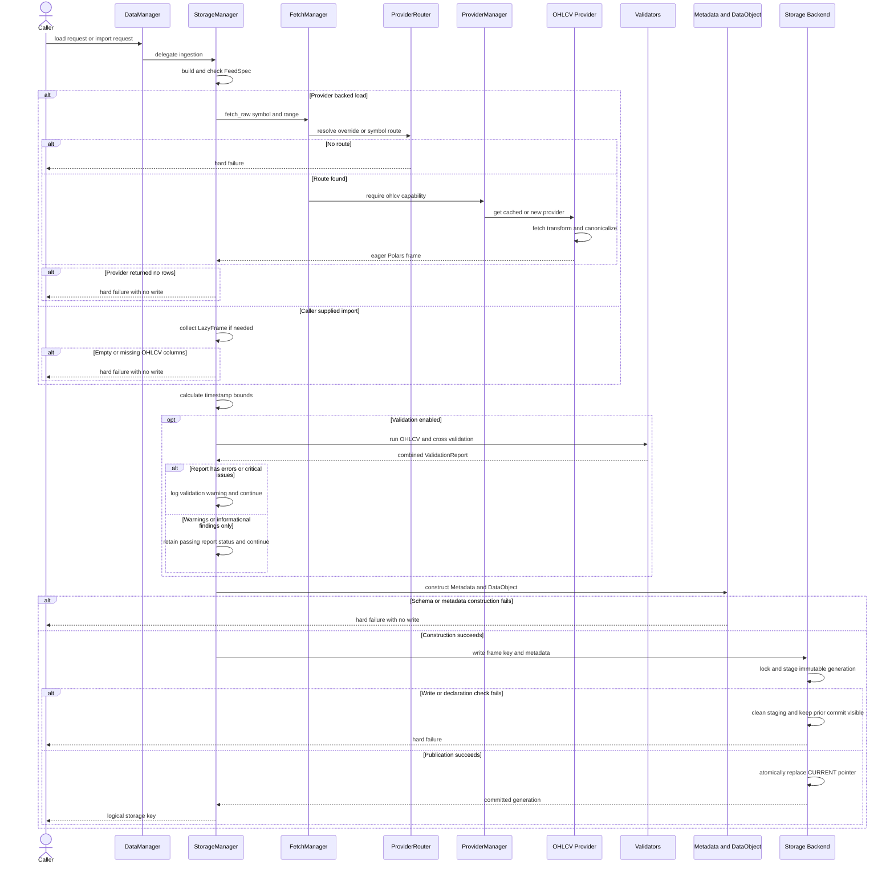

# Acquire, Validate, and Persist Data

`DataManager.load()` and `DataManager.import_data()` are the two initial-ingestion entry points. A load routes a symbol to an OHLCV provider and acquires data; an import accepts a caller-owned `Polars` `DataFrame` or `LazyFrame`. Both delegate to `StorageManager`, converge on feed-declaration checks, optional quality validation, metadata and `DataObject` construction, and one backend `write()`.

This workflow is specifically about creating or replacing a complete stored dataset. For component ownership and fetch-only behavior, see [DataManager Runtime](../architecture/data-manager-runtime.md). For the on-disk model, see [Storage and Metadata](../architecture/storage-and-metadata.md). Later merges and gap checks are covered by [Incremental Updates and Gaps](incremental-updates-and-gaps.md), while the meaning of calendars, timestamps, and identities is covered by [Data Time and Identity Contracts](../concepts/data-time-and-identity-contracts.md).

## Entry points and prerequisites

The `DataManager` facade creates a `StorageManager` only when a truthy storage backend is supplied. Consequently, both entry points fail before ingestion with `ValueError` when storage is absent. The constructor's `enable_validation` setting and optional `(message, progress)` callback are passed into that manager. Progress milestones are emitted for provider-backed loads; imports log their progress but do not use the callback milestones.

The signatures share the dataset identity and declaration inputs:

- `symbol`, `frequency`, `asset_class`, `bar_type`, optional `bar_threshold`, `exchange`, `calendar`, and `feed_spec`;
- `load()` additionally takes `start`, `end`, and an optional provider override;
- `import_data()` instead takes the frame and requires a provider name for provenance and later updates.

`load()` and `import_data()` are replacement operations. A load logs when its logical key already exists, but still writes a new complete value. Import writes the same way without a separate existence warning.

## End-to-end sequence



*Provider-backed loads and caller-supplied imports converge on declaration checks, validation, metadata construction, and atomic generation publication; validation findings warn, while structural failures prevent a write.*

## Provider-backed acquisition and canonicalization

`StorageManager.load()` first validates the ingestion declaration, then calls `FetchManager.fetch_raw()`. This path deliberately ignores the facade's requested output format and always works with an eager Polars frame.

`fetch_raw()` validates exact `YYYY-MM-DD` dates and rejects an end before the start. `ProviderRouter` gives an explicit `provider=` precedence; otherwise it uses the first matching configured regular expression. If neither produces a provider, acquisition fails. `ProviderManager` then requires the selected provider to advertise the `ohlcv` capability and returns a cached instance or constructs one.

For providers derived from `BaseProvider`, canonicalization happens before the frame reaches storage. The provider template validates request inputs, rate-limits, fetches and transforms provider-specific data under its circuit breaker, and invokes `ValidationMixin._validate_ohlcv()`. That mixin:

- normalizes a zero-column no-data result to an empty canonical frame;
- requires `timestamp`, `open`, `high`, `low`, `close`, and `volume`, and adds or verifies the requested `symbol`;
- requires timezone-aware timestamps and a string symbol, converts timestamps to microsecond UTC, uppercases the symbol, and casts OHLCV fields to `Float64`;
- rejects null canonical values, non-finite values, negative volume, mixed or wrong symbol identity, and duplicate `(timestamp, symbol)` rows;
- applies the provider's `ohlc_mode` to inconsistent OHLC rows, then sorts by timestamp and symbol while retaining provider-specific extra columns.

This provider boundary is strict and precedes the report-based validation described below. A provider may therefore fail acquisition rather than return a report. If it returns a canonical but empty frame, `load()` raises `ValueError("No data returned for ...")`; no metadata or dataset is written.

See [`base.py`](../../src/ml4t/data/providers/base.py) and [`validation.py`](../../src/ml4t/data/providers/mixins/validation.py) for the provider template and canonical contract.

## Caller-supplied import is intentionally less transformative

`import_data()` accepts a Polars `DataFrame` or `LazyFrame`; a lazy frame is collected. The helper also has a pandas-like conversion path internally, although the public facade annotation exposes only the Polars types. An empty frame is rejected, as is a frame missing any of `timestamp`, `open`, `high`, `low`, `close`, or `volume`.

Import does **not** run the provider canonicalization mixin and does not call `DataObject.to_canonical_schema()`. Instead, `timestamp_bounds()` requires a Datetime timestamp column with at least one non-null value, and `DataObject` requires the five OHLCV fields to be numeric-compatible. Extra columns, timestamp precision, null observations, and accepted numeric widths are not silently repaired or discarded by this workflow. `DataObject.to_canonical_schema()` remains an explicit utility that casts standard fields, adds default `dividends` and `splits`, and selects canonical columns, but callers must opt into it themselves.

This distinction matters when building a file or custom-provider adapter: normalize at the adapter boundary if the provider canonical contract is desired; do not assume `import_data()` will uppercase symbols, sort rows, deduplicate timestamps, or cast the stored frame. Tests also establish that imported nanosecond-adjacent observations and declared session labels survive the storage handoff.

## Feed declaration gate

Before acquisition for a load—and before frame conversion for an import—`_ingestion_feed()` turns `feed_spec` into a `FeedSpec`. A dictionary first passes through storage-metadata normalization. With no declaration, ingestion starts from a version 2 time contract.

The gate enforces these invariants:

1. A declared `data_frequency`, when present, must match the requested `frequency`. Common aliases such as `1d` and `1day`, `1h` and `1hour`, and `1m` and `1min` are normalized for this comparison.
2. A declared `bar_type`, when present, must match the requested `bar_type`.
3. An explicit `calendar` argument overrides the feed calendar and selects time-contract version 2.
4. Constructing `SessionAssigner(feed_spec=feed)` forces the temporal declaration and resolved calendar to be usable before data is fetched or stored.

Only temporal declaration fields are copied from the feed into `Metadata`: calendar, contract version, timezone, timestamp semantics, session start, grid anchor, bar label, and partial-bar policy. Physical bar identity is represented separately by `Metadata.bar_type` and `bar_params`. This preserves the meaningful difference between an omitted calendar and an explicit `calendar=None` declaration.

## Quality validation and report semantics

When `enable_validation=True`, both paths run the same `_validate_data()` pipeline. `ValidationRulePresets.for_asset_class()` accepts singular and common plural class names and configures thresholds and policies. It drives two validators whose results are added to one in-memory `ValidationReport`:

- `OHLCVValidator` performs structural numeric and finite-value checks, then configured checks for nulls, OHLC relationships, negative prices and volume, duplicate timestamps, chronological order, stale closes, and extreme returns.
- `CrossValidator` checks close-to-next-open continuity, rolling volume spikes, and calendar-aware records outside selected sessions. Its public API can compare a reference frame as well, but ingestion does not supply one in this workflow.

Severity controls report status. Adding an `ERROR` or `CRITICAL` issue marks its `ValidationResult` failed; `WARNING` and `INFO` findings do not. `ValidationReport.passed` is true only when every contained result passes, and the report aggregates critical, error, warning, and total counts.

The ingestion policy is advisory, not rejecting: even a failed report is logged and storage proceeds. `load()` logs critical, error, and warning counts; import logs the critical count. The report itself is neither returned nor added to the dataset metadata. Disable this quality pass with `enable_validation=False` when appropriate, but note that feed checks, timestamp bounds, `Metadata` validation, and `DataObject` schema validation remain hard gates.

This is the key failure distinction:

- **hard failures**—no storage, invalid declaration, route/provider/fetch failure, empty data, missing or invalid structural fields, invalid metadata, or backend write failure—escape and prevent publication;
- **quality findings**—including report-level errors and critical issues—produce logs but do not block publication;
- **warnings and informational findings** do not make a report fail and also do not block publication.

## Metadata and logical identity

After timestamp bounds are known, both paths create `Metadata` with:

- provider provenance (`provider` for imports, or the explicit provider and otherwise `"auto"` for loads);
- `symbol`, `asset_class`, `exchange`, `bar_type`, and bar parameters;
- the checked temporal declaration;
- `start_date` and `end_date` from actual frame bounds, not the requested load range;
- `last_updated` in UTC and a legacy string-valued `data_range` copy.

For time bars, `bar_params` contains `{"frequency": frequency}`. For non-time bars it contains `{"threshold": bar_threshold}` only when a threshold was supplied. `Metadata` normalizes and serializes its time declaration through `FeedSpec`, and `DataObject` pairs that metadata with the frame while enforcing the required timestamp and numeric OHLCV shape.

Both entry points choose the logical key:

```text
{asset_class}/{frequency}/{symbol}
```

Provider, exchange, bar type, threshold, and calendar are **not** key components. Two ingestions that share asset class, frequency, and symbol therefore target the same dataset even if those other attributes differ; the later successful write replaces the visible generation. Callers needing parallel variants must choose distinct logical identities rather than relying on metadata alone.

The `provider="auto"` value records that routing selected the source; it does not resolve the actual routed provider name into initial-load metadata.

## Atomic persistence boundary

`StorageManager` passes the frame, logical key, and `Metadata.model_dump()` to `storage.write()`. In the built-in `FlatStorage` and `HiveStorage` backends, the write lock covers one logical key. The backend validates the storage feed, creates an unpublished staging directory, writes the complete Parquet file or partition set, and builds commit metadata containing row count, schema, backend details, and the domain metadata under `custom`.

Publication then moves staging to an immutable generation, writes a commit record, and atomically replaces the key's `CURRENT` pointer. Readers resolve only that pointer, so they see either the prior complete generation or the newly published complete generation—not a partially written replacement. On any exception during staging or publication, the backend removes staging and re-raises; an existing published generation remains visible. This is why `DataManager` rejects the removed `use_transactions` option: supported storage writes already publish atomically at the backend boundary.

The atomic guarantee belongs to a conforming backend implementation. `DataManager` accepts a storage object by protocol-like behavior and does not wrap an arbitrary custom backend in an additional transaction.

## Focused verification

The most relevant tests are:

- [`test_data_manager_storage.py`](../../tests/test_data_manager_storage.py): storage-required failures, load overwrite behavior, progress callbacks, logical keys, import of eager and lazy frames, empty and missing-column failures, metadata, and atomic backend use;
- [`test_market_input_handoff.py`](../../tests/test_market_input_handoff.py): preservation of precision and source observations, calendar-presence semantics, temporal declarations, invalid declaration replacement safety, and real Flat/Hive round trips;
- [`test_validation_report.py`](../../tests/test_validation_report.py): severity aggregation, report pass/fail behavior, serialization, and composition of OHLCV and cross-validator results.

When extending this workflow, test the boundary being changed. Provider normalization belongs in provider tests; ingestion policy belongs in storage-manager tests; time declarations require handoff tests against both built-in layouts; and publication changes require interruption-safety tests proving that the old `CURRENT` commit remains readable.
