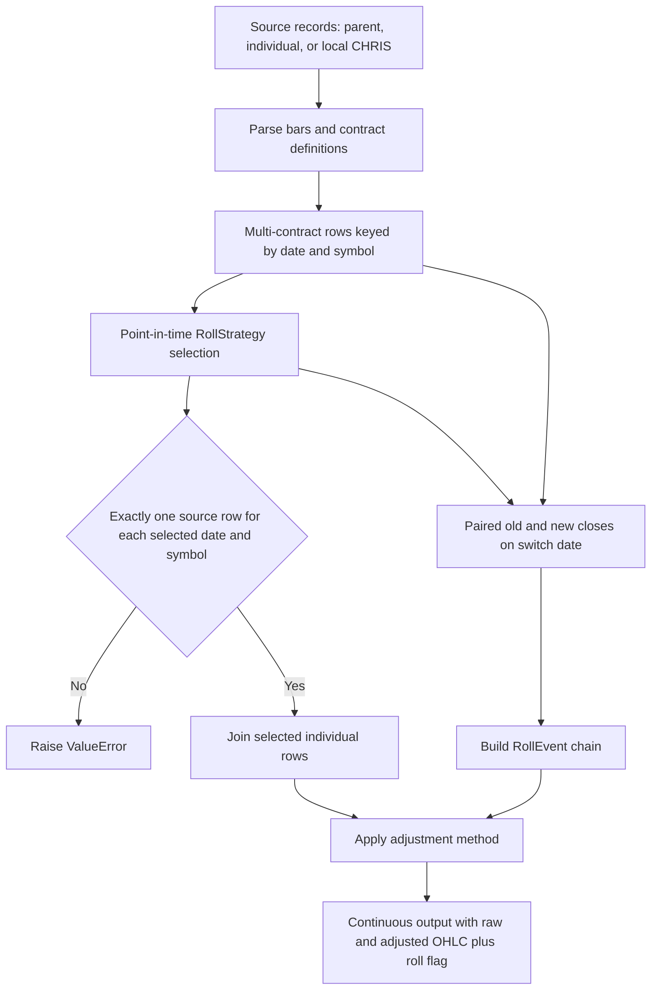

# Futures Acquisition and Continuous Contracts

The futures subsystem owns the parts of the data lifecycle that are specific to expiring contracts: contract specifications, futures symbology, acquisition of contract chains, selection of one contract at each observation date, roll events, and price adjustment. It does **not** own the generic provider registry or storage engines. Those boundaries matter because a product root, an exchange-listed contract, and a continuous series are different identities even when they share the same root text.

Databento is one supported source, not a prerequisite for the model. Local legacy CHRIS Parquet can feed the same construction path, and the package protects Databento-backed downloader exports behind the optional `databento` extra. See [Provider System](../integrations/provider-system.md), [Data Time and Identity Contracts](../concepts/data-time-and-identity-contracts.md), and [Storage and Metadata](../architecture/storage-and-metadata.md) for the generic layers around this workflow.

## Three symbol kinds

Keep these identities explicit throughout acquisition and storage:

| Kind | Examples | Meaning and owner |
|---|---|---|
| Parent | `ES.FUT`, requested with `stype_in="parent"` | A vendor query that expands to all listed outright contracts for a product. `FuturesDownloader` uses it to acquire the raw chain locally; it is not a single tradable series. |
| Individual | `ESH25`, `CLZ24`, requested with `stype_in="raw_symbol"` | One listed expiration. `IndividualDownloader` generates month-code/year symbols, while raw parsers retain the symbol on every observation so local roll logic can preserve identity. |
| Continuous | `ES.v.0`, `ES.c.1`, requested with `stype_in="continuous"` | A vendor-pre-rolled series. `.v.` means volume roll, `.c.` calendar roll, and the final integer is tenor rank. `ContinuousDownloader` stores these directly; this is separate from building a continuous series from individual contracts. |

A targeted single-series provider request must not use parent symbology or universe-like symbols: doing so could expand one storage key into unrelated contracts. The targeted Databento provider preserves exact aware timestamp bounds and the resolved individual contract appears separately in its `contract` field. This generic targeted path is appropriate for gap recovery of an already identified continuous symbol, not for downloading an entire parent chain.

## Contract definitions and symbol parsing

[`ContractSpec`](../../src/ml4t/data/futures/schema.py) is the static specification for a product root. It declares exchange, asset class, multiplier, tick size and value, quote units, settlement type, listed month codes, and optional notice/last-trade offsets. Construction validates supported units, increasing mixed-unit bounds, and the invariant `tick_value == tick_size * multiplier` within tolerance. `calculate_contract_value()` should be preferred over directly multiplying normalized parser prices, because a source may quote cents while parser output is dollars.

[`parse_contract_symbol()`](../../src/ml4t/data/futures/databento_parser.py) separates the product root, standard month code, month, and year. Four-digit years are unambiguous. One- and two-digit years require a `reference_year` and resolve to the unique nearest matching year; an exact tie, invalid month code, absent product, or malformed year is rejected. Definition-derived expiration supplies the reference year when `get_contract_chain()` parses downloaded contracts, and invalid entries such as spreads are skipped there.

Databento definitions provide dated lifecycle facts such as expiration. The normal parent downloader can acquire full `definition` history alongside bars and statistics. `DefinitionsDownloader` offers a cheaper snapshot workflow: one day per configured year and product, spread filtering, then latest-snapshot-per-symbol deduplication. It writes both raw snapshots and merged product definitions. This merged file is useful for coverage and chain construction, but it is not a revision history: use dated, revision-aware definition facts with `prepare_futures_inputs()` when an `as_of` research decision must exclude facts that were not yet available.

## Acquisition choices

All network downloaders require `api_key` or `DATABENTO_API_KEY` and instantiate `databento.Historical`. Accessing downloader exports without the optional package gives an actionable `uv add 'ml4t-data[databento]'` error; parsing and continuous-contract logic remain usable without performing a Databento download.

### Parent-chain download for local construction

`FuturesDownloader(FuturesDownloadConfig(...))` is the broad acquisition entrypoint. For each product and configured schema—by default `ohlcv-1d`, `definition`, and `statistics`—it requests `{product}.FUT` with parent symbology, adds a `product` column, removes spread symbols from OHLCV and definitions, and writes one Parquet file per schema/product. `download_all()` and `download_all_parallel()` track completed and failed products, estimate cost, and can skip complete products. Incremental `update()` begins after the latest OHLCV timestamp, aligns old and new schemas, and deduplicates OHLCV by `(ts_event, symbol)` and definitions by `(ts_recv, raw_symbol)` before replacing the product file.

### Explicit individual contracts

`IndividualDownloader` generates symbols from configured years and month numbers, converts months through `MONTH_TO_CODE`, and sends the complete list as `raw_symbol`. Its default hourly schema is `ohlcv-1h`; each product is sorted by `ts_event, symbol` and stored as:

```text
<data-root>/futures/individual/{PRODUCT}/data.parquet
```

This path is useful for demonstrations and analyses that need the actual legs. It does not infer a roll or produce an adjusted series.

### Vendor continuous series

`ContinuousDownloader` requests all configured `{product}.{roll_type}.{tenor}` symbols in one call per product, then partitions the returned bars locally by event year:

```text
<data-root>/futures/continuous/product={PRODUCT}/year={YEAR}/data.parquet
```

Defaults are `ohlcv-1h`, volume roll (`roll_type="v"`), and tenors `[0, 1, 2]`. Existing nonempty product-year files support resume checks. These files already embody Databento's roll rule and must not be confused with the output of `ContinuousContractBuilder`.

### Legacy CHRIS input

`parse_quandl_chris_raw()` reads a local Parquet path, `ML4T_QUANDL_CHRIS_PATH`, or the configured futures storage default. The remote CHRIS dataset is no longer acquired by this package. It standardizes close using `settle`, then `close`, `last`, and `open`; fills missing OHLC values from that standardized close; and normalizes declared quote units. Mixed cents/dollars are accepted only when the `ContractSpec` supplies a plausible normalized range. `parse_quandl_chris()` then chooses the highest-volume row per date, while `parse_quandl_chris_raw()` retains all contracts. Local continuous construction rejects raw CHRIS rows without a `symbol`, because a safe roll cannot be inferred from duplicate dates alone.

## From records to one continuous series



*The construction path preserves individual identity until one-to-one validation, then derives roll events and adjusted continuous output.*

The principal entrypoints are `ContinuousContractBuilder.build()` and the convenience `build_continuous_contract()`. They accept `data_source="quandl_chris"` or `"databento"`; the latter loads locally downloaded files rather than making a network call. The default policy is `VolumeBasedRoll()` plus additive `BackAdjustment()`.

### Point-in-time selection

Every `RollStrategy` returns chronological `(date, symbol)` selections, with at most one symbol per date. Volume and open-interest strategies rank a **previous observation**, so the current day's metric is not used to select itself. `VolumeBasedRoll` additionally supports a confirmation window and minimum civil days between switches. Deterministic ties use a declared tie-breaker and then symbol. The candidate must actually be observed on its effective date.

Expiry-aware alternatives have different requirements:

- `TimeBasedRoll` selects the nearest eligible expiration until its pre-expiry trigger. Business-day mode uses an explicit/feed calendar (NYSE is the feed default), while civil-day mode subtracts elapsed days. It never substitutes an earlier observation for a missing target session.
- `FirstNoticeDateRoll` prefers actual `first_notice_date` facts. For legacy physical contracts without them, it can estimate from `ContractSpec.first_notice_days`; cash-settled or unspecified contracts fall back to the time rule.
- `CalendarRoll(rank)` selects an unexpired expiration rank; `HighestVolumeRoll(rank)` and `HighestOpenInterestRoll(rank)` select lagged metric ranks and support minimum thresholds.

For causal, revision-aware research preparation, `prepare_futures_inputs()` is the stronger boundary. It joins source bars to dated instrument definitions, filters bar/definition revisions and independently published ranking metrics at `as_of`, normalizes explicitly declared units, groups chains by root and exchange, and returns `FuturesInputs`. Its outputs separate normalized raw `bars`, used `definitions`, identity `chain`, eligible `metrics`, one current `selections` decision per chain, paired raw-mark `rolls`, `coverage`, and metadata describing calendar, perspective, selection method, and roll scope. It prepares facts and proposals; it does not claim execution fills or account policy.

### One-to-one checks and roll events

Before joining selections, the builder counts raw observations by `(date, symbol)`. A selection with zero or multiple matching rows fails rather than silently dropping or duplicating a date. A symbol change becomes a `RollEvent(date, old_symbol, new_symbol, old_close, new_close)`, and both closes must be finite, unique observations from the switch date. This same-date pairing is what makes the discontinuity measurable without using a synthetic continuous price.

### Price adjustment

Adjustment changes only the derived `adjusted_open`, `adjusted_high`, `adjusted_low`, and `adjusted_close` columns; raw selected OHLC remains available.

- `BackAdjustment` adds `new_close - old_close` to every observation strictly before each roll. The roll-day row itself is the new contract and is not shifted.
- `RatioAdjustment` multiplies pre-roll history by `new_close / old_close`. Zero closes and opposite-sign ratios are undefined and rejected.
- `NoAdjustment` copies raw OHLC into the adjusted columns.

Validation permits one event per date, requires every event date in the selected series, checks that the selected roll-day symbol is the new leg, and requires adjacent events to form a connected symbol chain.

## Data contracts and persistence

The canonical parsed multi-contract frame contains:

```text
date, symbol, open, high, low, close, volume, open_interest, expiration
```

`parse_databento_raw()` derives `date` from `ts_event`, attaches expiration from definitions, and left-joins the latest daily open-interest statistic by `(date, symbol)` when available. Missing definitions produce nullable expiration; missing statistics produce nullable `open_interest`. `parse_databento()` is only a convenience front-month view: it picks highest same-day volume and returns `date`, OHLC, `volume`, and nullable `open_interest`, dropping contract identity.

The local builder output retains selected raw columns, including `symbol` when present, adds the four `adjusted_*` columns, and adds `is_roll_date`. The flag is true only on effective symbol switches, not merely when relative volume changes.

Filesystem defaults always pass through `resolve_storage_path` and the package data root. Parent-chain data uses:

```text
<data-root>/futures/ohlcv_1d/product={PRODUCT}/ohlcv_1d.parquet
<data-root>/futures/definition/product={PRODUCT}/definition.parquet
<data-root>/futures/statistics/product={PRODUCT}/statistics.parquet
```

An explicit `storage_path` overrides these defaults. See [Configuration and CLI](../operations/configuration-and-cli.md) for data-root resolution. Error-marker Parquet rows from unavailable parent schemas are filtered by loaders; an empty new response does not overwrite an existing file.

## Safe extension and verification

Add a source by producing the multi-contract schema with explicit `date` and `symbol`; do not mix network acquisition into symbol/calendar parsing. Add selection behavior by implementing `RollStrategy.select_contracts()` and preserving one selection per date, lag/availability semantics, deterministic ties, and observed-contract checks. Add an adjustment by implementing `AdjustmentMethod.adjust()` while retaining raw prices and validating explicit `RollEvent` inputs.

The focused suite is:

```bash
uv run pytest tests/futures -q -ra
```

High-value regression areas are covered by `test_roll.py` (lagged decisions, availability, ties, expiry boundaries, paired closes), `test_adjustment.py` (additive/ratio math and invalid chains), `test_continuous.py` (source dispatch, one-to-one joins, roll flags, end-to-end gaps), parser tests (symbol years, definitions, OI, CHRIS units), downloader tests (symbology and persistence), and `test_prepared_inputs.py` (dated definitions, revisions, independent metric availability, unit declarations, and causal `as_of`). `tests/test_targeted_databento_acquisition.py` separately protects exact half-open timestamp requests, rejection before billable calls, single-series identity, and non-destructive storage backfill behavior.
