# Incremental Updates, Gap Detection, and Backfill

There are three related update surfaces:

- `DataManager.update()` is the user-facing managed path. It delegates to `StorageManager.update()`, which owns initial-load fallback, provider selection, overlap fetching, validation-compatible merging, gap reporting, and dataset metadata.
- `IncrementalUpdater` is the lower-level strategy engine. Callers supply already-fetched `new_data`, a storage key, and optionally a `MetadataTracker`; it chooses replacement semantics but does not contact a provider itself.
- `ProviderUpdater` is a provider-integration template for specialized subclasses. It resolves a provider-specific time range, calls subclass fetch/transform hooks, and asks an `IncrementalStorageBackend` to save a chunk, update a combined file, and update metadata.

These are complementary, not interchangeable. The managed path is the normal route when provider routing and canonical `asset_class/frequency/symbol` keys are desired. Use `IncrementalUpdater` when orchestration already owns fetching and needs explicit `INCREMENTAL`, `APPEND_ONLY`, `FULL_REFRESH`, or `BACKFILL` behavior. See also [Acquire, Validate, and Persist](acquire-validate-and-persist.md), [Storage and Metadata](../architecture/storage-and-metadata.md), and [Data, Time, and Identity Contracts](../concepts/data-time-and-identity-contracts.md).

## Decision and write flow

```mermaid
flowchart TD
    A["Update request"] --> B{"Managed dataset exists"}
    B -- No --> C["Initial load with explicit or bounded default history"]
    C --> W1["Write fetched source observations and metadata"]
    B -- Yes --> D{"Daily data already current"}
    D -- Yes --> N["Return key with no write"]
    D -- No --> E["Fetch overlap window and merge by timestamp"]
    E --> W2["Atomic replacement preserving metadata"]

    A --> S{"Lower-level strategy"}
    S -- Incremental --> I["Replace overlapping timestamps and append newer rows"]
    S -- Append-only --> P["Discard rows at or before stored maximum"]
    S -- Full-refresh --> F["Use supplied frame as complete replacement"]
    S -- Backfill --> G["Select source rows inside detected expected gaps"]
    I --> W3["Atomic replacement"]
    P --> W4{"Any later rows"}
    W4 -- Yes --> W3
    W4 -- No --> N2["Success with no write"]
    F --> W3
    G --> H{"Valid new source observations"}
    H -- Yes --> W3
    H -- No --> N3["Report remaining gaps with no write"]
```

*The two entry paths converge on no-op outcomes or complete storage replacements; gap classification itself never creates observations.*

## Managed update lifecycle

### 1. Initial-load fallback

`StorageManager.update()` forms the key `asset_class/frequency/symbol`. If it does not exist, update becomes `load()` rather than an empty incremental merge. `initial_end` defaults to today. `initial_start` wins when supplied; otherwise the start is today minus `initial_load_days` (365 by default), capped by the selected provider's declared `capabilities().max_history_days`. An explicit `initial_start` is not silently shortened by that capability.

The initial load fetches through `FetchManager.fetch_raw()`, rejects an empty response, optionally validates it, derives timestamp bounds, builds `Metadata`, and writes the frame. Its metadata records provider, symbol, asset class, bar type and parameters, exchange, temporal contract, range, and update time.

### 2. Reuse identity and temporal declarations

For an existing dataset, the manager reads both data and normalized storage metadata. Unless the caller overrides `provider`, it reuses a stored provider other than `None`, `""`, or `"auto"`; a non-string stored provider is rejected. This avoids accidentally routing an existing series to a different vendor. Likewise, stored feed metadata supplies the calendar and bar contract unless `feed_spec` or `calendar` explicitly overrides it. Requested frequency and bar type must agree with the effective feed declaration.

### 3. Bound and overlap the request

The fetch starts at the last stored timestamp minus `lookback_days` and ends at the current UTC time. The overlap intentionally lets revised provider rows replace stored rows. If the provider declares a maximum history, the start is moved forward to no earlier than `fetch_end - max_history_days`; metadata notes when that bound leaves the effective start after the last stored date. Daily data less than one elapsed day old returns immediately as current, and an empty provider result also leaves storage unchanged.

This current check is deliberately simple elapsed-time logic. Calendar-aware gap classification happens later and should not be confused with the decision to skip a same-day daily fetch.

### 4. Align, merge, and report

Before concatenation, `align_frames_for_concat()` reconciles schemas and supplies neutral corporate-action defaults (`dividends=0.0`, `splits=1.0`) on either side. The managed merge concatenates old and fetched frames, deduplicates on `timestamp` with the fetched/latest occurrence winning, and sorts chronologically.

When `check_gaps` is true and the effective feed resolves a calendar, the merged frame is inspected. Gap checks on non-time bars are rejected because a fixed expected grid is unavailable. Detection only produces a report; it does not alter `merged_df`. The manager stores `gap_check_performed`, `gap_count`, `missing_observations`, `provider_history_limited`, and always `gaps_filled=False` in metadata attributes. Passing legacy `fill_gaps=False` disables checking; passing `fill_gaps=True` fails before any initial dataset can be created.

Finally, the manager reconstructs typed metadata, retaining valid prior model fields and custom attributes, refreshing the range and update timestamps, and writing with `preserve_metadata=True`. Invalid optional legacy metadata fields may be dropped after validation, but provider, symbol, asset class, and temporal-contract fields are not treated as disposable.

## What a gap means

A gap is a missing **expected observation**, not merely a long wall-clock interval:

- For daily feeds, timestamps are projected to civil session labels under the selected exchange calendar. Weekends, holidays, and early closes are therefore not missing equity sessions. A missing early-close day still counts as one missing observation. A `24/7` calendar expects weekend sessions.
- An explicit `calendar=None` disables schedule-based classification and returns no calendar gaps. An explicit calendar override takes precedence over feed metadata; version-2 metadata with a declared null calendar also disables checks.
- For intraday data, detection requires a complete version-2 fixed-time bar grid: frequency, timestamp semantics, grid anchor, bar label, partial-bar policy, and sufficient timezone information. The expected grid is built from tradable intervals and calendar breaks; off-grid timestamps are errors.
- Rows marked `is_imputed=True` are placeholders and are excluded from the set of observed rows. The marker must be Boolean.

There are two `GapDetector` APIs. `ml4t.data.utils.gaps.GapDetector` returns `DataGap` objects and is used by the managed update path. `ml4t.data.update_manager.GapDetector` returns dictionaries such as daily `{start, end, size_days}` or intraday `{start, end, size_bars}`, supports explicit coverage bounds, storage reads, per-entity reports, and backfill row selection. For storage checks, requested bounds are inclusive even though backend read end bounds are exclusive.

**Gap checks classify absence; they never impute prices, volume, or timestamps.** `utils.gaps.GapDetector.fill_gaps()` rejects synthetic filling whenever gaps are present. A grid-completion feature elsewhere may expose null placeholders, but those are not market observations and are deliberately ignored by update gap detection.

## Lower-level range selection

`IncrementalUpdater.determine_update_range()` normalizes requested bounds to UTC and rejects a reversed range. Missing storage, unreadable storage/metadata, or a dataset with no observed rows yields the full requested range and update type `"full"`. If the requested end is already covered, it returns `"none"` with a degenerate end/end range.

For an incomplete existing range:

- Without a calendar, it overlaps the last real row rather than inventing a next expected bar.
- With a calendar, it checks expected observations from the later of the stored end and requested start through the requested end, then starts at the first detected gap. If no expected gaps remain, the result is `"none"`.

This method plans a range only. The caller is responsible for downloading it and passing the resulting frame to `update_incremental()`.

## Strategy semantics

All rewrite strategies first align existing and incoming schemas. Their behavior is:

| Strategy | Existing timestamps | Later timestamps | Write result |
| --- | --- | --- | --- |
| `INCREMENTAL` | Incoming rows replace equal timestamps | Appended | Sorted complete replacement; counts overlap as updated and later rows as added |
| `APPEND_ONLY` | Ignored, even if values differ | Only rows strictly after the stored maximum are appended | Replacement only when later rows exist |
| `FULL_REFRESH` | Discarded | Supplied frame is authoritative | Complete replacement; empty or timestamp-less replacement is rejected |
| `BACKFILL` | Preserved as observations | Only supplied rows that land in currently detected gaps are eligible | Replacement only if valid recovered rows add or replace placeholder identities |

If no dataset exists, each strategy writes the supplied frame. `update_incremental()` itself first requires a `timestamp` column, converts operational exceptions into a failed `UpdateResult`, and updates the external tracker only after a successful storage strategy. Overlap is keyed by timestamp in ordinary incremental mode; callers should therefore use one instrument per key unless they have designed a stronger identity boundary.

### Atomic replacement and metadata

Rewrite paths call `_rewrite_preserving_metadata()`. It refuses empty/timestamp-less frames, recomputes stored start/end bounds, refreshes recency fields, and writes with `preserve_metadata=True`. Flat and Hive backends stage an immutable generation and publish data plus storage metadata through one atomic `CURRENT` pointer, so readers see the old or new generation rather than a partial replacement.

`MetadataTracker` is separate from that storage commit. It writes per-key dataset metadata and an update-history JSON under file locks, retains the latest 100 history entries, and exposes recent-first history and basic stale/error health checks. Consequently, dataset publication and tracker history are ordered but are not one cross-file transaction. Backfill explicitly reports an error such as “observations stored but update history failed” if publication succeeded and tracker maintenance did not.

## Backfill: source recovery, not fabrication

`BackfillManager.identify_candidates()` scans recent stored datasets, resolves each feed's calendar, and retains gaps meeting daily-session or intraday-bar thresholds. `prioritize_tasks()` scores larger gaps, older data, and caller-assigned importance more highly.

`execute_backfill()` rechecks the requested ranges against storage before downloading, because a stale task may already have been resolved. Daily recovery uses `provider.fetch_ohlcv()` over civil dates. Intraday recovery requires `TimestampRangeProvider.fetch_ohlcv_range()`, an exact fixed grid, and left-labeled bars. Provider errors are collected per gap; success means processing completed without errors, not necessarily that every expected observation exists, so callers must inspect `remaining_gaps`.

Recovery enforces identity and provenance:

- A stored provider must match the selected provider.
- A path-like storage key requires a separate `source_symbol`; the key itself is not assumed to be a vendor symbol.
- Provider-returned `symbol` values must identify exactly the requested source instrument.
- A keyed entity series must contain at most one instrument for targeted recovery, and merged recovery cannot introduce a different stored instrument identity.
- Only provider rows that fall on the expected missing sessions or bar positions are selected. Existing real observations win; placeholders at the same identity may be replaced. Schema alignment marks recovered rows as non-imputed where needed.

Thus backfill may introduce only valid observations returned by the source for expected gaps while preserving instrument identity. It never synthesizes OHLCV values, and unresolved market absences remain visible in `remaining_gaps`.

## Provider-specific template extension

Subclass `ProviderUpdater` when a provider needs a reusable fetch-transform-save template. Implement `_fetch_data()`, `_transform_data()`, and `_get_default_start_time()`. Incremental range resolution starts near the backend's latest timestamp using `latest - safety_margin + 1 minute`; full refresh or absent data uses the subclass default. A start at or after the end becomes an `already_up_to_date` success. `dry_run=True` reports transformed rows without writes, and `update_symbols()` can process symbols with up to four workers by default.

Its save sequence is chunk audit file, combined-file update, then metadata update. That protocol-level sequence has different persistence semantics from the generation replacement used by `StorageManager` and `IncrementalUpdater`; an implementation of `IncrementalStorageBackend` owns its consistency guarantees.

## Operational invariants and failure behavior

- Storage must be configured for managed loads and updates. Existing empty data is an error; empty newly fetched data is a no-op.
- Managed fetch retries exhausted by Tenacity become a `ValueError`; other fetch, calendar, schema, or storage failures propagate.
- Lower-level `update_incremental()` returns failures in `UpdateResult.errors`; direct `apply_strategy()` calls can raise validation/storage exceptions.
- Daily and intraday classifications require trustworthy feed/calendar metadata. Do not “fix” a report by changing the calendar to match observed data; the calendar is the independent expectation.
- Keep provider overlap windows large enough for the vendor's revision behavior, but remember provider history bounds may truncate them.
- Backfill completion must be judged from a fresh gap report, not from rows fetched or a successful HTTP call.

Focused regression coverage lives in `tests/test_incremental_update_system.py`, `tests/test_update_manager.py`, `tests/test_daily_session_gaps.py`, and `tests/test_preserve_market_absences.py`. These tests pin overlap replacement, append-only and full-refresh behavior, metadata-preserving rewrites, inclusive bounds, exchange-session classification, rejection of synthetic imputation, preservation of observed nulls and historical absences, and source-backed backfill.
